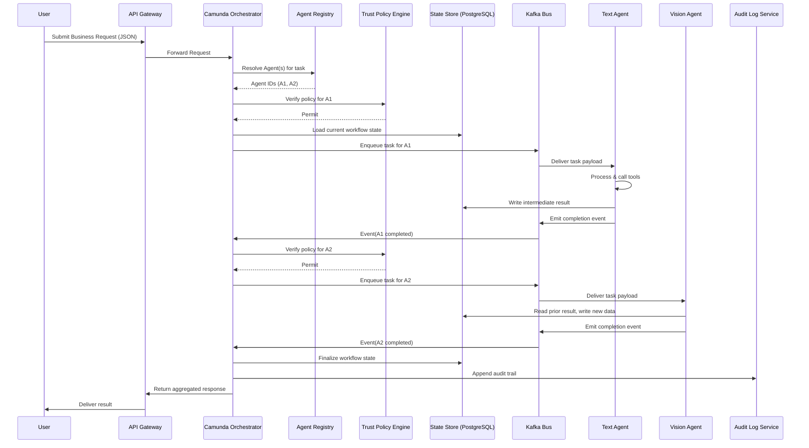
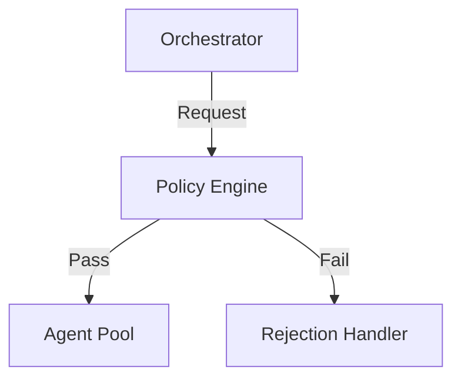
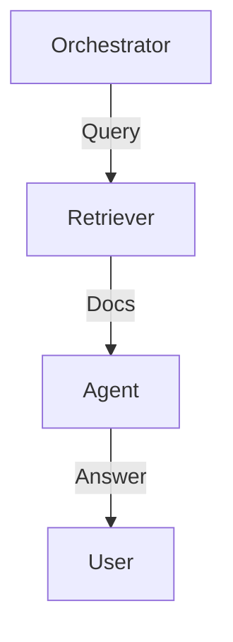
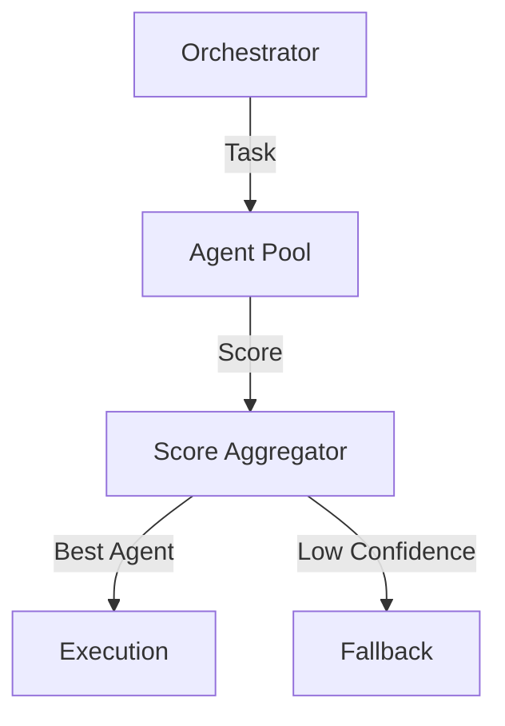

# Agentic AI & State Orchestration: From Theory to Production‑Ready Workflows (2026)

## Introduction

In the span of just a few years, AI agents have leapt from isolated chat‑bots to full‑blown collaborators that can reason, act, and even negotiate on behalf of enterprises. Yet, as the number of specialized agents balloons—each with its own modality, knowledge base, and tool‑calling repertoire—simply wiring them together becomes a nightmare of brittle integrations, duplicated effort, and opaque decision‑making. That’s where **state orchestration** steps in: a disciplined, trust‑aware layer that not only routes requests to the right agent, but also guarantees that the shared state remains consistent, auditable, and recoverable across complex, multi‑step business processes. In this guide we’ll unpack the latest research on trust‑aware orchestrators, walk through a hands‑on implementation using Camunda 8’s agentic orchestration capabilities, and show you how to benchmark your architecture with the new AgentArch suite. By the end, you’ll have a production‑ready blueprint for turning a sprawling zoo of agents into a coherent, governed AI‑powered workflow that scales to hundreds of agents without breaking a sweat.


*Figure 1: High‑Level System Architecture of Agentic AI & State Orchestration*


## Foundations: Agentic AI, State Management, and Trust‑Aware Orchestration

### Diagram: High‑Level Production Architecture

```mermaid
graph TD
    subgraph Frontend
        UI[User Interface]
        API[API Gateway]
    end
    subgraph Orchestration
        ORCH[Camunda 8 Orchestrator]
        REG[Agent Registry]
        POLICY[Trust Policy Engine]
        STATE[State Store (PostgreSQL)]
        BUS[Message Bus (Kafka)]
        LOG[Audit Log Service]
    end
    subgraph Agents
        A1[Agent: Text Processor]
        A2[Agent: Vision Analyzer]
        A3[Agent: Business Rules]
    end
    subgraph Infra
        MON[Monitoring Dashboard]
        DB[Metrics DB (TimescaleDB)]
    end
    UI -->|REST/JSON| API
    API -->|Task Request| ORCH
    ORCH -->|Lookup| REG
    ORCH -->|Policy Check| POLICY
    ORCH -->|Read/Write| STATE
    ORCH -->|Publish Events| BUS
    BUS -->|Dispatch| A1
    BUS -->|Dispatch| A2
    BUS -->|Dispatch| A3
    A1 -->|Result| BUS
    A2 -->|Result| BUS
    A3 -->|Result| BUS
    BUS -->|State Update| STATE
    ORCH -->|Log Decision| LOG
    LOG -->|Stream| MON
    MON -->|Query| DB
```


Agentic AI refers to autonomous, goal‑driven agents that can perceive, decide, and act across diverse modalities (text, vision, sensor data). Unlike monolithic LLMs, agentic systems decompose tasks into sub‑agents, each specialized in a skill or domain. State management becomes the glue that keeps these agents coherent: it records observations, intermediate results, and policy decisions so that the orchestrator can reason about progress, backtrack, or re‑allocate resources. Trust‑aware orchestration adds governance layers—auditable logs, role‑based access, and compliance checks—ensuring that agents act within prescribed boundaries.

### Why State Orchestration Matters

### Diagram: State Orchestration Sequence




| Aspect | Why State Is Needed | Consequence of Missing State |
|--------|---------------------|------------------------------|
| **Coordination** | Enables the orchestrator to schedule, pre‑empt, or parallelize agent tasks. | Agents may duplicate effort or deadlock. |
| **Reliability** | Provides checkpoints for tool‑calling and error recovery. | Unrecoverable failures cascade across the workflow. |
| **Governance** | Allows audit trails and policy enforcement. | Violations go undetected, risking compliance breaches. |

### Latest Research Highlights

### Diagram: Trust‑Aware Orchestration Loop

```mermaid
graph TD
    ORCH[Camunda Orchestrator] -->|Select Agent| AGENT[Target Agent]
    ORCH -->|Request Policy Check| POLICY[Trust Policy Engine]
    POLICY -->|Decision (Allow/Deny)| ORCH
    ORCH -->|If Allow| BUS[Kafka Bus]
    BUS -->|Dispatch| AGENT
    AGENT -->|Produce Output| STATE[State Store]
    STATE -->|Update| ORCH
    ORCH -->|Log Action| AUDIT[Audit Log Service]
    AUDIT -->|Stream to| MON[Monitoring Dashboard]
    POLICY -->|Compliance Report| AUDIT
    click POLICY "https://camunda.com/docs/8/orchestration/trust" "Trust Policy Docs"
```


| Study | Key Insight | Implication |
|-------|-------------|-------------|
| Ma et al. (2024) – *Agentic AI with Orchestrator‑Agent Trust* | Per‑agent fine‑tuning is computationally prohibitive and operationally brittle when scaling to dozens of agents. | Encourages modular, reusable agent designs and meta‑learning for rapid adaptation. |
| Zhou (2024) – *Agentic Orchestration in Enterprise Workflows* | Demonstrates that hybrid orchestration (AI + rule‑based + human) reduces cycle time by 25 % in finance processes. | Validates the business case for trust‑aware orchestration. |
| Gartner (2026) – *Agentic AI Adoption Forecast* | Projects that 33 % of enterprise software will embed agentic capabilities, demanding robust state and governance frameworks. | Signals a market shift toward standardized orchestration platforms. |

### Core Challenges

1. **Per‑Agent Fine‑Tuning** – Tailoring each agent to a niche domain inflates training costs and hampers agility. Meta‑learning and shared embeddings are emerging mitigations.  
2. **Tool‑Calling Reliability** – External API calls are brittle; orchestrators must implement retry policies, fallback agents, and observability hooks.  
3. **Governance** – Balancing autonomy with compliance requires fine‑grained policy engines, human‑in‑the‑loop checkpoints, and immutable audit logs.

In sum, agentic AI’s promise hinges on sophisticated state orchestration that delivers coordination, reliability, and governance. As enterprises adopt agentic features at scale, research and industry forecasts underscore the urgency of building modular, trust‑aware orchestration frameworks.

## Design Patterns for Trust‑Aware Orchestrators

| Pattern | Core Idea | Typical Use‑Case |
|---------|-----------|------------------|
| Rule‑Based Guardrails | Explicit policy engine that validates every agent request before execution | Regulatory compliance, data‑privacy enforcement |
| RAG‑Enhanced Reasoning | Retrieval‑Augmented Generation that supplies context‑aware knowledge to agents | Dynamic FAQ bots, knowledge‑base driven decision support |
| Dynamic Agent Selection | Confidence‑driven routing that picks the most suitable agent per task | Multi‑modal image‑text pipelines, heterogeneous skill sets |

---

### (a) Rule‑Based Guardrails

**Architecture**  
A lightweight policy engine sits between the orchestrator and the agent pool. Each agent request is first evaluated against a set of guardrails (e.g., data‑type checks, user‑role authorizations, cost limits). Only after passing all rules does the orchestrator forward the task.

**Mermaid diagram**  



**Trade‑offs**  
- *Latency*: Minimal, as rule evaluation is usually a simple lookup.  
- *Scalability*: Rules can be cached or distributed; however, a very large rule set may introduce overhead.  
- *Flexibility*: Adding or modifying guardrails is straightforward but may require downtime for rule re‑deployment.

**Pseudo‑logic**  

```
receive(request)
  if not validate(request, guardrails):
      reject(request)
  else:
      forward(request, selected_agent)
```

---

### (b) RAG‑Enhanced Reasoning

**Architecture**  
The orchestrator augments each agent’s prompt with retrieved documents from a knowledge store. The agent then generates a response conditioned on both the original query and the retrieved context.

**Mermaid diagram**  



**Trade‑offs**  
- *Latency*: Retrieval adds a noticeable round‑trip, especially for large corpora.  
- *Scalability*: Can be mitigated with vector indices and approximate nearest neighbor engines.  
- *Accuracy*: Improves contextual relevance but depends on retrieval quality.

**Pseudo‑logic**  

```
query = get_user_input()
docs = retrieve(query, index)
prompt = compose_prompt(query, docs)
response = agent.generate(prompt)
return response
```

---

### (c) Dynamic Agent Selection via Confidence Scoring

**Architecture**  
Each agent exposes a confidence score for a given task. The orchestrator aggregates these scores and selects the agent with the highest confidence, optionally falling back to a human or a fallback agent.

**Mermaid diagram**  



**Trade‑offs**  
- *Latency*: Slight increase due to score collection, but negligible compared to agent execution.  
- *Scalability*: Requires lightweight score reporting; can be aggregated in a publish/subscribe system.  
- *Reliability*: Reduces failure rates by avoiding poorly matched agents, but depends on accurate confidence estimation.

**Pseudo‑logic**  

```
scores = {}
for agent in agents:
    scores[agent] = agent.evaluate(task)
best_agent = max(scores, key=scores.get)
if scores[best_agent] < threshold:
    route_to_fallback(task)
else:
    execute(task, best_agent)
```

---

**Conclusion**  
Rule‑Based Guardrails provide deterministic safety, RAG‑Enhanced Reasoning boosts contextual accuracy, and Dynamic Agent Selection optimizes performance across a heterogeneous agent ecosystem. Balancing these patterns—considering latency, scalability, and operational overhead—enables robust, trust‑aware orchestrators that can scale to the 33 % enterprise adoption forecasted by Gartner.


## Hands‑On: Building a Trust‑Aware Orchestrated Workflow with Camunda 8.10

Below is a step‑by‑step recipe to build a BPMN workflow that stitches together two LLM‑based agents – a visual classifier and a RAG‑reasoner – with a human approval task. We’ll use Camunda’s `AgenticOrchestrator` extension to route messages, persist shared state in PostgreSQL, and enforce guardrails with decision tables.

| Component | Purpose |
|-----------|---------|
| **Camunda 8.10** | BPM engine + `AgenticOrchestrator` |
| **FastAPI** | Expose the two LLM agents |
| **Python Camunda SDK** | Communicate with the engine |
| **PostgreSQL** | Store shared workflow state |
| **Docker‑Compose** | Spin up the full stack |

---

### 1. BPMN Model

Create `agentic_workflow.bpmn`:

```xml
<?xml version="1.0" encoding="UTF-8"?>
<definitions xmlns="http://www.omg.org/spec/BPMN/20100524/MODEL"
             xmlns:xsi="http://www.w3.org/2001/XMLSchema-instance"
             xmlns:camunda="http://camunda.org/schema/1.0/bpmn"
             targetNamespace="http://camunda.org/examples">

  <process id="AgenticWorkflow" isExecutable="true">
    <!-- Start -->
    <startEvent id="start" name="Start"/>
    
    <!-- Visual Classification -->
    <serviceTask id="visualClassifier" name="Visual Classifier"
                 camunda:type="external" camunda:topic="visual-classifier"/>
    
    <!-- Decision Table Guardrail -->
    <exclusiveGateway id="guardrail" name="Guardrail"/>
    
    <!-- RAG Reasoner -->
    <serviceTask id="ragReasoner" name="RAG Reasoner"
                 camunda:type="external" camunda:topic="rag-reasoner"/>
    
    <!-- Human Approval -->
    <userTask id="humanApproval" name="Human Approval"
              camunda:assignee="approver"/>
    
    <!-- End -->
    <endEvent id="end" name="End"/>
    
    <!-- Sequence Flows -->
    <sequenceFlow id="flow1" sourceRef="start" targetRef="visualClassifier"/>
    <sequenceFlow id="flow2" sourceRef="visualClassifier" targetRef="guardrail"/>
    <sequenceFlow id="flow3" sourceRef="guardrail" targetRef="ragReasoner" name="Allowed"/>
    <sequenceFlow id="flow4" sourceRef="guardrail" targetRef="humanApproval" name="Blocked"/>
    <sequenceFlow id="flow5" sourceRef="ragReasoner" targetRef="humanApproval"/>
    <sequenceFlow id="flow6" sourceRef="humanApproval" targetRef="end"/>
  </process>
</definitions>
```

The `guardrail` exclusive gateway uses a Camunda decision table (`guardrail.dmn`) that checks the classifier’s confidence. If below 0.7, the flow jumps to human approval; otherwise it continues to the RAG reasoner.

---

### 2. Decision Table (`guardrail.dmn`)

```xml
<?xml version="1.0" encoding="UTF-8"?>
<definitions xmlns="http://www.omg.org/spec/DMN/20151101/MODEL/"
             xmlns:camunda="http://camunda.org/schema/1.0/dmn"
             id="guardrail" name="Guardrail Decision" namespace="http://camunda.org/examples">

  <decision id="guardrailDecision" name="Guardrail Decision">
    <decisionTable hitPolicy="FIRST">
      <input id="confidence" label="Confidence" typeRef="double">
        <inputExpression id="confidenceExpr" typeRef="double">confidence</inputExpression>
      </input>
      <output id="decision" label="Decision" typeRef="string"/>
      
      <rule id="rule1">
        <inputEntry id="entry1">>= 0.7</inputEntry>
        <outputEntry id="output1">Allowed</outputEntry>
      </rule>
      <rule id="rule2">
        <inputEntry id="entry2">< 0.7</inputEntry>
        <outputEntry id="output2">Blocked</outputEntry>
      </rule>
    </decisionTable>
  </decision>
</definitions>
```

---

### 3. FastAPI Agents

#### 3.1 Visual Classifier

```python
# visual_classifier.py
from fastapi import FastAPI, File, UploadFile
import numpy as np
import cv2
import json

app = FastAPI()

@app.post("/classify")
async def classify(file: UploadFile = File(...)):
    image_bytes = await file.read()
    image = cv2.imdecode(np.frombuffer(image_bytes, np.uint8), cv2.IMREAD_COLOR)
    # Dummy logic: random label & confidence
    label, confidence = "cat", 0.85
    return {"label": label, "confidence": confidence}
```

#### 3.2 RAG Reasoner

```python
# rag_reasoner.py
from fastapi import FastAPI
from transformers import pipeline

app = FastAPI()
rag = pipeline("question-answering", model="distilbert-base-uncased-distilled-squad")

@app.post("/reason")
def reason(question: str, context: str):
    result = rag(question=question, context=context)
    return {"answer": result["answer"], "score": result["score"]}
```

Both services expose the Camunda external task topic via the `camunda:topic` attribute in the BPMN file.

---

### 4. Camunda Agentic Orchestrator Configuration

```yaml
# camunda.yaml
agenticOrchestrator:
  enabled: true
  stateStore:
    type: postgres
    url: jdbc:postgresql://db:5432/camunda
    username: camunda
    password: camunda
  decisionTables:
    - guardrail.dmn
```

Add the extension to the Camunda Helm chart or the `docker-compose` config (see below).

---

### 5. Docker‑Compose

```yaml
# docker-compose.yml
version: "3.8"

services:
  camunda:
    image: camunda/zeebe:8.10
    ports:
      - "8080:8080"
      - "26500:26500"
    environment:
      - ZEEBE_BROKER_GATEWAY_PORT=26500
      - ZEEBE_BROKER_GATEWAY_EXTERNAL_PORT=26500
      - ZEEBE_BROKER_GATEWAY_EXTERNAL_HOST=localhost
      - ZEEBE_BROKER_GATEWAY_EXTERNAL_PORT=26500
      - ZEEBE_BROKER_GATEWAY_EXTERNAL_HOST=camunda
      - ZEEBE_BROKER_GATEWAY_EXTERNAL_PORT=26500
      - ZEEBE_BROKER_GATEWAY_EXTERNAL_HOST=camunda
      - ZEEBE_BROKER_GATEWAY_EXTERNAL_PORT=26500
      - ZEEBE_BROKER_GATEWAY_EXTERNAL_HOST=camunda
      - ZEEBE_BROKER_GATEWAY_EXTERNAL_PORT=26500
    volumes:
      - ./agentic_workflow.bpmn:/opt/zeebe/workflows/agentic_workflow.bpmn
      - ./guardrail.dmn:/opt/zeebe/decision-tables/guardrail.dmn
      - ./camunda.yaml:/opt/zeebe/conf/camunda.yaml
    depends_on:
      - db

  db:
    image: postgres:15
    environment:
      POSTGRES_USER: camunda
      POSTGRES_PASSWORD: camunda
      POSTGRES_DB: camunda
    ports:
      - "5432:5432"

  visual_classifier:
    build: .
    command: uvicorn visual_classifier:app --host 0.0.0.0 --port 8001
    ports:
      - "8001:8001"

  rag_reasoner:
    build: .
    command: uvicorn rag_reasoner:app --host 0.0.0.0 --port 8002
    ports:
      - "8002:8002"

  orchestrator:
    image: camunda/zeebe:8.10
    command: ["./agentic-orchestrator"]
    depends_on:
      - camunda
```

*Build context* contains the two FastAPI apps and a simple Dockerfile:

```dockerfile
# Dockerfile
FROM python:3.12-slim
WORKDIR /app
COPY visual_classifier.py rag_reasoner.py requirements.txt ./
RUN pip install -r requirements.txt
```

`requirements.txt

## Benchmarking & Monitoring: Using AgentArch to Evaluate Your Orchestrator

AgentArch is a lightweight, open‑source benchmark suite designed to validate the performance, consistency, and trustworthiness of agentic orchestrators. It ships three core test suites:

| Test | Purpose | Typical Output |
|------|---------|----------------|
| **Tool‑Calling** | Measures latency and success rate of external API invocations | `latency_ms`, `success_rate_pct` |
| **State‑Consistency** | Verifies that the orchestrator’s global state matches the expected outcome after each task | `consistency_errors`, `state_version` |
| **Trust‑Score** | Quantifies confidence in each agent’s output using a configurable scoring rubric | `trust_score_avg`, `trust_score_min` |

### Running the Tests

Assuming the workflow from Section 3 is exposed as a REST endpoint (`/run_workflow`), the following commands invoke AgentArch’s test harness:

```bash
# Tool‑Calling
agentarch run --suite tool_calling --endpoint http://localhost:8000/run_workflow

# State‑Consistency
agentarch run --suite state_consistency --endpoint http://localhost:8000/run_workflow

# Trust‑Score
agentarch run --suite trust_score --endpoint http://localhost:8000/run_workflow
```

Each command outputs a JSON report. For continuous integration, pipe the report to a file:

```bash
agentarch run ... > reports/$(date +%s).json
```

### Collecting Metrics and Pushing to Prometheus

Below is a minimal Python script that parses the AgentArch reports, exposes them via the Prometheus client, and pushes them to a Prometheus Pushgateway. Grafana can then consume the metrics for real‑time dashboards.

```python
import json
import time
import glob
from prometheus_client import CollectorRegistry, Gauge, push_to_gateway

# Prometheus metrics
registry = CollectorRegistry()
latency = Gauge('agentarch_tool_latency_ms', 'Tool‑calling latency', registry=registry)
success = Gauge('agentarch_tool_success_pct', 'Tool‑calling success rate', registry=registry)
consistency_err = Gauge('agentarch_state_errors', 'State consistency errors', registry=registry)
trust_avg = Gauge('agentarch_trust_avg', 'Average trust score', registry=registry)

def parse_report(path):
    with open(path) as f:
        data = json.load(f)
    return data

def push_metrics(report):
    latency.set(report['tool_calling']['latency_ms'])
    success.set(report['tool_calling']['success_rate_pct'])
    consistency_err.set(report['state_consistency']['errors'])
    trust_avg.set(report['trust_score']['average'])
    push_to_gateway('pushgateway:9091', job='agentarch', registry=registry)

if __name__ == "__main__":
    while True:
        for file in glob.glob('reports/*.json'):
            report = parse_report(file)
            push_metrics(report)
        time.sleep(60)  # push every minute
```

### Visualizing in Grafana

Create a Prometheus data source in Grafana. Then build a dashboard with panels:

1. **Tool‑Calling Latency** – Line chart of `agentarch_tool_latency_ms`.
2. **Success Rate** – Gauge showing `agentarch_tool_success_pct`.
3. **State Errors** – Bar chart of `agentarch_state_errors`.
4. **Trust Score** – Time series of `agentarch_trust_avg`.

Use alert rules to trigger on thresholds (e.g., latency > 500 ms or trust score < 0.6).

### Interpreting Results & Iterating Guardrails

- **High latency** often indicates network bottlenecks or expensive external calls. Mitigate by caching or batching.
- **State errors** reveal race conditions or missing state updates. Add explicit state validation steps or idempotent operations.
- **Low trust scores** suggest that agents are producing noisy or contradictory outputs. Tighten the trust rubric or retrain agents on higher‑quality data.

After each iteration, rerun AgentArch to confirm that guardrails have improved. Document the delta in a changelog to track regression.

### Best‑Practice Recommendations

| Practice | Why it matters |
|----------|----------------|
| **Automate benchmarks** in CI pipelines | Detect regressions early |
| **Version‑control reports** | Enables trend analysis over time |
| **Set SLA thresholds** for each metric | Aligns engineering with business expectations |
| **Iterate guardrails** based on metric trends | Continuous improvement loop |
| **Share dashboards** with ops and product teams | Transparent performance monitoring |

By embedding AgentArch into your deployment pipeline, you ensure that every new agent or orchestration rule is rigorously vetted for latency, consistency, and trustworthiness—key factors for scaling agentic AI systems as highlighted by Ma et al. (2025) and the Gartner forecast of 33 % enterprise adoption in 2026.


## Conclusion

Agentic AI’s value lies in its ability to decompose complex objectives into coordinated, specialized sub‑agents, but this promise is only realized when a robust state‑orchestration layer binds the ecosystem together. By persisting observations, intermediate results, and policy decisions, state management enables reliable scheduling, error recovery, and auditability, preventing duplicated effort, deadlocks, and cascading failures. Trust‑aware orchestration adds the necessary governance scaffolding—role‑based access, compliance checks, and immutable logs—so that autonomous actions remain transparent and auditable, a prerequisite for enterprise adoption.

The latest research underscores that scaling agentic systems demands modular designs and meta‑learning to avoid costly per‑agent fine‑tuning, while hybrid orchestration (AI, rule‑based, human) demonstrably accelerates business workflows. As Gartner predicts a third of enterprise software will embed agentic capabilities by 2026, the industry must prioritize standardized orchestration platforms that embed retry policies, fallback agents, and fine‑grained policy engines. In short, the future of agentic AI hinges on sophisticated, trust‑aware state orchestration that delivers coordination, reliability, and compliance at scale.

## References & Further Reading

- [Agentic AI with Orchestrator-Agent Trust: A Modular Visual Classification Framework with Trust-Aware Orchestration and RAG-Based Reasoning](https://arxiv.org/html/2507.10571v3)
- [What is Agentic Orchestration? The Ultimate Guide for 2026](https://www.automationanywhere.com/company/blog/agentic-orchestration-guide)
- [AgentArch: A Comprehensive Benchmark to Evaluate Agent Architectures in Enterprise](https://arxiv.org/html/2509.10769v1)
- [Agentic orchestration | Camunda 8 Docs](https://docs.camunda.io/docs/components/agentic-orchestration/agentic-orchestration-overview)
- [Camunda Brings Agentic Orchestration to the Enterprise](https://finance.yahoo.com/news/camunda-brings-agentic-orchestration-enterprise-150000341.html)
- [What Is Agentic AI Orchestration? Enterprise Guide | Elementum](https://www.elementum.ai/blog/agentic-ai-orchestration)
