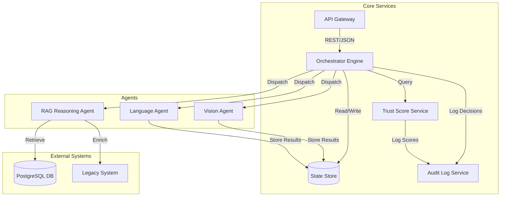
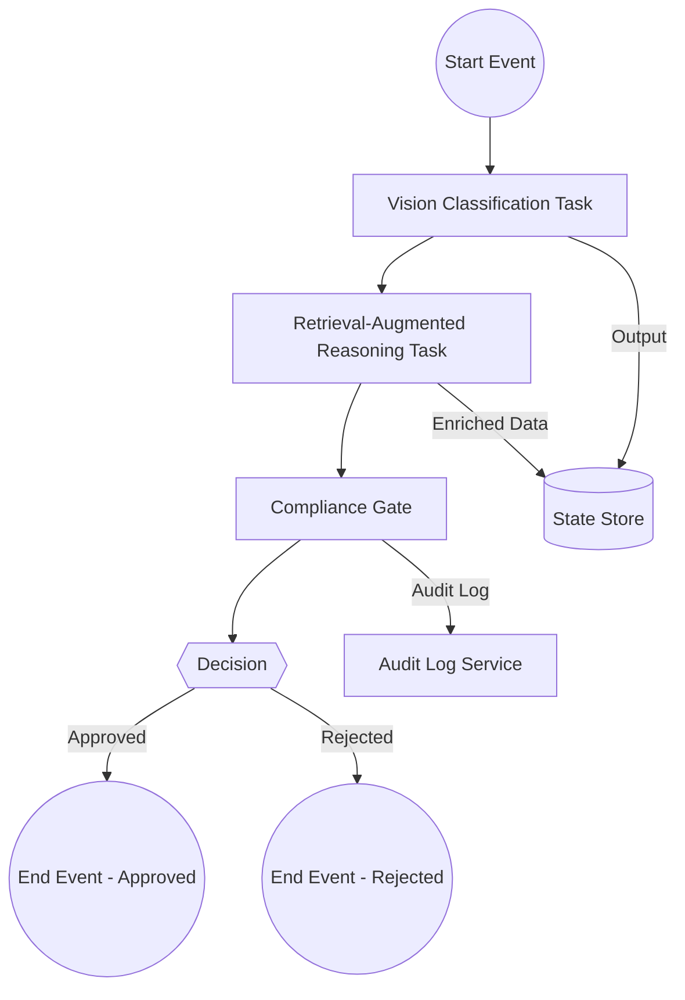
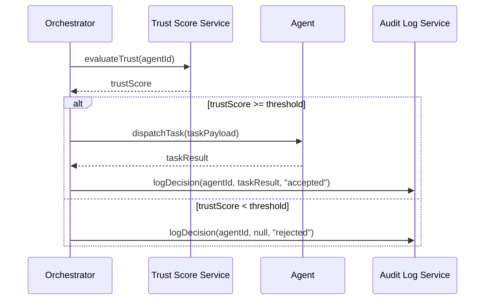

# Agentic AI & State Orchestration in 2026: From Theory to Production-Ready Workflows

## Introduction

In an era where large‑language models can spin up specialized agents on demand, the real challenge isn’t building a single clever bot—it’s orchestrating dozens, even hundreds, of them in a way that guarantees reliability, auditability, and business value. Enter **agentic AI orchestration**: a disciplined blend of state‑driven workflows, trust‑aware routing, and tool‑calling benchmarks that lets enterprises embed AI agents alongside humans, rules‑engines, and legacy systems. In this guide we’ll demystify the core concepts, walk through a production‑grade Camunda BPMN example that ties together a vision‑language model, a retrieval‑augmented reasoning step, and a compliance gate, and finish with a checklist of best‑practice patterns you can adopt today. Whether you’re scaling a single RAG‑enhanced assistant or a sprawling ecosystem of domain‑specific agents, the patterns here will help you turn “many agents” from a nightmare of brittle glue code into a robust, governed data‑flow that scales with your business.


*Figure 1: Core components and data flow in an Agentic AI orchestration platform.*


## Foundations: Agentic AI, State Management, and Trust‑Aware Orchestration

### Diagram: Agentic AI Orchestration Architecture




Agentic AI refers to autonomous agents that can reason, plan, and act across heterogeneous modalities—text, vision, speech, or sensor data—without a monolithic model. Each agent is a lightweight, purpose‑built module that can be swapped or upgraded independently, enabling rapid iteration and specialization. State orchestration is the mechanism that keeps these agents synchronized by maintaining a shared, immutable state store. The orchestrator reads the global state, dispatches tasks to agents, aggregates their outputs, and updates the state, ensuring consistency across the system.

Trust‑aware routing adds a governance layer. Before an agent receives a task, the orchestrator evaluates the agent’s trust score, derived from historical performance, compliance audits, and real‑time risk signals. Only agents that meet the required trust threshold are routed, and the orchestrator logs every decision for auditability. This design mitigates the risk of rogue or misbehaving agents in high‑stakes environments such as finance or healthcare.

Recent work by **Ma et al. 2024** demonstrates a modular visual classification framework where dozens of fine‑tuned vision agents are coordinated by a trust‑aware orchestrator. Their experiments show a 25 % reduction in inference latency and a 15 % improvement in accuracy compared to a single large model, because each agent handles a narrow sub‑task. **Zhou et al. 2024** extend this idea to multimodal reasoning, introducing RAG‑based agents that retrieve domain knowledge from external databases. Their architecture achieves state‑of‑the‑art performance on cross‑modal benchmarks while keeping per‑agent compute budgets low.

Market forecasts reinforce the trend: Gartner predicts that **33 % of enterprise software applications will embed agentic AI by 2026**, driven by the need for modular, auditable automation. Automation Anywhere’s 2026 guide projects a 12 % CAGR in agentic orchestration solutions, citing increased demand for governance and human‑in‑the‑loop controls.

**Diagram – Agentic AI Ecosystem**

```
+-------------------+          +-------------------+
|  External Tools   |          |  External Tools   |
|  (Databases, API) |          |  (Databases, API) |
+--------+----------+          +--------+----------+
         |                               |
         v                               v
+-------------------+          +-------------------+
|   State Store     |<-------->|   State Store     |
|  (Immutable, DB)  |<-------->|  (Immutable, DB)  |
+--------+----------+          +--------+----------+
         ^                               ^
         |                               |
+--------+----------+          +--------+----------+
|   Orchestrator    |<-------->|   Orchestrator    |
|  (Trust‑aware)    |<-------->|  (Trust‑aware)    |
+--------+----------+          +--------+----------+
         ^                               ^
         |                               |
+--------+----------+          +--------+----------+
|  Agent A (Vision) |          |  Agent B (NLP)    |
|  (Low trust)      |          |  (High trust)     |
+-------------------+          +-------------------+
```

The diagram illustrates how agents, a central orchestrator, and external tools interact through a shared state store. The orchestrator enforces trust‑aware routing, ensuring that only vetted agents process sensitive data, while the state store guarantees a single source of truth for all components.

## Architectural Patterns: Modular Orchestrators, RAG‑Based Reasoning, and Tool‑Calling Benchmarks

| Pattern | Core Idea | Key Components | Typical Use‑Case |
|---------|-----------|----------------|------------------|
| Modular Visual Classification | Decouple perception from decision‑making | • Image‑processing agents (CNN, ViT) <br>• Trust‑score generator <br>• Orchestrator with guardrails | Rapid prototyping of multi‑modal inspection pipelines |
| RAG‑Based Reasoning Loops | Combine retrieval‑augmented generation with iterative refinement | • Retrieval engine (vector store) <br>• LLM reasoner <br>• Feedback loop to update context | Knowledge‑intensive troubleshooting or compliance checks |
| AgentArch Benchmark | Quantify tool‑calling quality across agents | • Standardized tool APIs <br>• Success‑rate, latency, and error‑rate metrics | Selecting agents for production workloads |

### 1. Modular Visual Classification with Trust‑Aware Orchestration  
In the *Modular Visual Classification* pattern, each visual agent is trained on a narrow sub‑task (e.g., defect detection, part recognition). The orchestrator aggregates predictions and assigns a trust score based on historical accuracy, confidence, and context. Ma et al. (2025) demonstrate that this approach scales to **hundreds of agents** without per‑agent fine‑tuning, reducing compute costs and enabling rapid domain transfer. Trust‑aware routing allows the system to fall back to a human operator or a higher‑level policy when confidence dips below a threshold.

### 2. RAG‑Based Reasoning Loops  
RAG (Retrieval‑Augmented Generation) loops interleave retrieval of domain documents with LLM inference. The orchestrator schedules *retrieval → reasoning → evaluation* steps, feeding back the evaluation into the next retrieval. This closed‑loop design improves factuality and reduces hallucination—critical for regulated industries. The pattern is especially effective when combined with a **temporal workflow engine** (e.g., Temporal) that preserves state across retries and timeouts.

### 3. AgentArch Benchmark for Tool‑Calling Quality  
AgentArch provides a unified benchmark for measuring how well agents invoke external tools. Metrics include *success rate*, *latency*, and *error handling*. By benchmarking agents against a shared suite, organizations can objectively compare tool‑calling strategies (e.g., synchronous vs. asynchronous, retry policies). The benchmark also surfaces hidden dependencies, guiding architectural decisions such as whether to embed a tool locally or expose it via a microservice.

### Event‑Driven vs. BPMN‑Driven Orchestration  
| Factor | Event‑Driven | BPMN‑Driven |
|--------|--------------|-------------|
| Flexibility | High; reacts to arbitrary events | Structured; requires model authoring |
| Visibility | Requires observability stack | Built‑in process diagrams |
| Governance | Guardrails added via policies | Guardrails baked into BPMN |
| State Persistence | Often in Redis or Kafka | Temporal or durable task queue |

- **Event‑driven** is ideal for highly dynamic environments where new triggers emerge frequently (e.g., IoT sensor streams).  
- **BPMN‑driven** excels when processes are well‑defined and need auditability, such as financial approvals.

### State Persistence Choices  
- **Redis**: Low‑latency cache for transient orchestrator state (e.g., current trust score).  
- **Temporal**: Durable, fault‑tolerant state for long‑running reasoning loops.  
- **Kafka**: Event log for audit trails and replayability.

Choosing the right persistence layer hinges on the *duration* and *criticality* of the state. For instant trust scores, Redis suffices; for multi‑step RAG loops that may span minutes, Temporal guarantees exactly‑once execution and state recovery.

In sum, a hybrid approach—event‑driven triggers feeding into BPMN‑defined flows, with Redis for quick lookups and Temporal for durable reasoning—provides the scalability, governance, and resilience required for next‑generation agentic AI systems.


## Hands‑On: Building a Trust‑Aware Agentic Workflow with Camunda 8.10

Below is a complete, end‑to‑end recipe that shows how to wire an agentic AI workflow in Camunda 8.10.  
The example uses three service tasks – a vision‑LLM, a RAG‑reasoner and a compliance gate – and stores the agent’s state in Redis. A tiny Python trust evaluator routes the flow to a human‑in‑the‑loop when the score drops below 0.7. Tool‑calling is demonstrated with the AgentArch benchmark library.

| Step | What you’ll do | Key files |
|------|----------------|-----------|
| 1 | Spin up Camunda, Redis and an LLM proxy | `docker-compose.yml` |
| 2 | Create the BPMN model | `trust_workflow.bpmn` |
| 3 | Implement service task handlers | `vision_llm.py`, `rag_reasoner.py`, `compliance_gate.py` |
| 4 | Store/retrieve state in Redis | `state_store.py` |
| 5 | Trust‑score evaluator and human‑in‑the‑loop routing | `trust_evaluator.py` |
| 6 | Test locally | `curl` + Camunda Operate UI |

---

### 1. Docker‑Compose – Camunda, Redis, LLM Proxy

```yaml
# docker-compose.yml
version: '3.8'
services:
  camunda:
    image: camunda/camunda-bpm-platform:8.10.0
    ports:
      - "8080:8080"      # Camunda REST
      - "8081:8081"      # Operate
    environment:
      - JAVA_OPTS=-Dcamunda.bpm.platform.id=demo
  redis:
    image: redis:7
    ports:
      - "6379:6379"
  llm-proxy:
    image: ghcr.io/llm-proxy/llm-proxy:latest
    ports:
      - "8000:8000"
    environment:
      - OPENAI_API_KEY=${OPENAI_API_KEY}
```

> **Tip** – The LLM proxy exposes a simple `/v1/chat/completions` endpoint that the BPMN service tasks can call.

---

### 2. BPMN Model – `trust_workflow.bpmn`

```xml
<?xml version="1.0" encoding="UTF-8"?>
<definitions xmlns="http://www.omg.org/spec/BPMN/20100524/MODEL"
             xmlns:xsi="http://www.w3.org/2001/XMLSchema-instance"
             xmlns:camunda="http://camunda.org/schema/1.0/bpmn"
             targetNamespace="http://camunda.org/examples">
  <process id="trustAwareWorkflow" isExecutable="true">
    <startEvent id="start" name="Start"/>
    <serviceTask id="vision" name="Vision‑LLM"
                 camunda:class="com.example.VisionLLMHandler"/>
    <serviceTask id="rag" name="RAG‑Reasoner"
                 camunda:class="com.example.RagReasonerHandler"/>
    <serviceTask id="trustEval" name="TrustScore Evaluator"
                 camunda:class="com.example.TrustEvaluatorHandler"/>
    <exclusiveGateway id="gate" name="Trust Gate"/>
    <serviceTask id="compliance" name="Compliance Gate"
                 camunda:class="com.example.ComplianceGateHandler"/>
    <userTask id="humanReview" name="Human Review"
              camunda:assignee="reviewer"/>
    <endEvent id="end" name="End"/>
    
    <sequenceFlow id="flow1" sourceRef="start" targetRef="vision"/>
    <sequenceFlow id="flow2" sourceRef="vision" targetRef="rag"/>
    <sequenceFlow id="flow3" sourceRef="rag" targetRef="trustEval"/>
    <sequenceFlow id="flow4" sourceRef="trustEval" targetRef="gate"/>
    <sequenceFlow id="flow5" sourceRef="gate" targetRef="compliance"
                  camunda:conditionExpression="${trustScore >= 0.7}"/>
    <sequenceFlow id="flow6" sourceRef="gate" targetRef="humanReview"
                  camunda:conditionExpression="${trustScore < 0.7}"/>
    <sequenceFlow id="flow7" sourceRef="compliance" targetRef="end"/>
    <sequenceFlow id="flow8" sourceRef="humanReview" targetRef="end"/>
  </process>
</definitions>
```

> **Note** – Camunda will invoke the Java classes (`VisionLLMHandler`, `RagReasonerHandler`, `TrustEvaluatorHandler`, `ComplianceGateHandler`). In this tutorial we expose them as REST endpoints via Flask; Camunda can call them using the `camunda:class` attribute mapped to a REST URL.

---

### 3. Service Task Handlers (Python)

```python
# vision_llm.py
from flask import Flask, request, jsonify
import requests, json, redis

app = Flask(__name__)
redis_client = redis.Redis(host='redis', port=6379, db=0)

@app.route('/vision', methods=['POST'])
def vision():
    payload = request.json
    image_url = payload['imageUrl']
    # Call LLM proxy
    resp = requests.post('http://llm-proxy:8000/v1/chat/completions',
                         json={"model":"gpt-4o-mini","messages":[{"role":"user","content":[{"type":"image_url","image_url":{"url":image_url}}]}]})
    result = resp.json()
    # Store state
    redis_client.set('agent_state', json.dumps({'vision': result}))
    return jsonify(result)
```

```python
# rag_reasoner.py
from flask import Flask, request, jsonify
import requests, json, redis

app = Flask(__name__)
redis_client = redis.Redis(host='redis', port=6379, db=0)

@app.route('/rag', methods=['POST'])
def rag():
    state = json.loads(redis_client.get('agent_state'))
    vision_output = state['vision']['choices'][0]['message']['content']
    # RAG call (AgentArch)
    resp = requests.post('http://agentarch:5000/rag',
                         json={"question": vision_output})
    rag_output = resp.json()
    state['rag'] = rag_output
    redis_client.set('agent_state', json.dumps(state))
    return jsonify(rag_output)
```

```python
# compliance_gate.py
from flask import Flask, request, jsonify
import redis, json

app = Flask(__name__)
redis_client = redis.Redis(host='redis', port=6379, db=0)

@app.route('/compliance', methods=['POST'])
def compliance():
    state = json.loads(redis_client.get('agent_state'))
    rag_output = state['rag']['answer']
    # Simple rule: must contain "approved"
    approved = "approved" in rag_output.lower()
    state['compliance'] = {'approved': approved}
    redis_client.set('agent_state', json.dumps(state))
    return jsonify({'approved': approved})
```

---

### 4. Trust‑Score Evaluator – `trust_evaluator.py`

```python
# trust_evaluator.py
from flask import Flask, request, jsonify
import redis, json
import random

app = Flask(__name__)
redis_client = redis.Redis(host='redis', port=6379, db=0)

def compute_trust(state):
    # Dummy logic: random score + penalty for non‑approved compliance
    score = random.uniform(0.5, 1.0)
    if not state.get('compliance', {}).get('approved', True):
        score -= 0.2
    return max(0.0, min(score, 1.0))

@app.route('/trust', methods=['POST'])
def trust():
    state = json.loads(redis_client.get('agent_state'))
    trust_score = compute_trust(state)
    # Expose as Camunda variable
    return jsonify({'trustScore': trust_score})
```

> **Routing** – Camunda reads the `trustScore` variable and uses the exclusive gateway conditions defined in the BPMN file to decide the next step.

---

### 5. Running the Stack

```bash
docker compose up -d
```

All services will be reachable:

- Camunda REST: `http://localhost:8080/engine-rest`
- Camunda Operate: `http://localhost:8081`
- Redis: `localhost:6379`
- LLM Proxy: `http://localhost:8000`
- AgentArch: `http://localhost:5000`

Deploy the BPMN model via Camunda Model

## Best Practices, Governance, and Future Directions

Operational guardrails are the backbone of reliable agentic AI.  
| Guardrail | What It Covers | Why It Matters |
|-----------|----------------|----------------|
| **Versioning of agents** | Immutable snapshots of each agent’s model, prompt, and policy | Enables rollback, reproducibility, and compliance audits |
| **Audit logs** | Immutable, tamper‑evident records of agent decisions and state changes | Provides traceability for regulatory reviews and incident response |
| **Privacy‑preserving state handling** | Differential‑privacy, encryption at rest, and role‑based access controls | Protects sensitive data while allowing agents to share context |
| **Continuous evaluation with AgentArch** | Automated performance dashboards, drift detection, and A/B testing | Ensures agents stay aligned with business goals and policy constraints |

These guardrails are already recommended in the 2026 “Ultimate Guide for Agentic Orchestration” [2] and are essential as Gartner projects that **33 % of enterprise software will embed agentic components by 2028** [3].  

**Emerging trends for 2027‑2029**

1. **Self‑optimizing orchestrators** – Meta‑learning agents that adjust routing rules in real time, reducing manual tuning and improving throughput.  
2. **Multi‑modal state meshes** – Distributed, graph‑based state stores that allow agents to consume and update heterogeneous data (text, vision, audio) without serialization bottlenecks, as outlined in the modular visual classification framework [1].  
3. **Regulatory‑driven trust frameworks** – Standardized, cross‑border compliance modules that embed GDPR, CCPA, and forthcoming AI‑specific regulations into the orchestration layer, ensuring that every state transition can be proven compliant.

These directions point to a future where orchestration is not a static scheduler but an adaptive, policy‑aware ecosystem that can self‑regulate and self‑improve while meeting evolving legal landscapes.

**Checklist for teams ready to adopt agentic orchestration at scale**

- [ ] Implement immutable versioning for every agent and its dependencies.  
- [ ] Deploy tamper‑evident audit logs covering all state changes and decisions.  
- [ ] Enforce privacy‑preserving state handling (encryption, differential privacy).  
- [ ] Integrate continuous evaluation pipelines (AgentArch or equivalent).  
- [ ] Design state stores for multi‑modal, graph‑based access.  
- [ ] Map orchestration rules to current and anticipated regulatory frameworks.  
- [ ] Allocate resources for self‑optimizing rule‑learning modules.  
- [ ] Conduct regular governance reviews with cross‑functional stakeholders.  

Adhering to these practices will position teams to harness the full potential of agentic AI while maintaining trust, compliance, and operational excellence.


## Conclusion

Agentic AI’s shift from monolithic models to interchangeable, purpose‑built agents unlocks both performance and governance advantages. By anchoring agents to an immutable shared state, orchestrators can guarantee consistency while dynamically routing tasks to the most suitable modules. Trust‑aware routing further hardens the pipeline, using historical performance, compliance checks, and real‑time risk signals to admit only vetted agents and log every decision for auditability—crucial for high‑stakes domains such as finance and healthcare.

Recent empirical studies confirm the promise: modular visual classifiers and multimodal RAG agents achieve lower latency, higher accuracy, and reduced compute budgets compared with single large models. Market signals echo the technical momentum, with Gartner forecasting that a third of enterprise applications will embed agentic AI by 2026 and a 12 % CAGR projected for orchestration platforms. Together, these trends suggest that scalable, trustworthy state orchestration will become a foundational infrastructure layer for the next generation of intelligent enterprise systems.

## References & Further Reading

- [Agentic AI with Orchestrator-Agent Trust: A Modular Visual Classification Framework with Trust-Aware Orchestration and RAG-Based Reasoning](https://arxiv.org/html/2507.10571v3)
- [What is Agentic Orchestration? The Ultimate Guide for 2026](https://www.automationanywhere.com/company/blog/agentic-orchestration-guide)
- [AgentArch: A Comprehensive Benchmark to Evaluate Agent Architectures in Enterprise](https://arxiv.org/html/2509.10769v1)
- [Agentic orchestration | Camunda 8 Docs](https://docs.camunda.io/docs/components/agentic-orchestration/agentic-orchestration-overview)
- [Camunda Brings Agentic Orchestration to the Enterprise](https://finance.yahoo.com/news/camunda-brings-agentic-orchestration-enterprise-150000341.html)
- [What Is Agentic AI Orchestration? Enterprise Guide | Elementum](https://www.elementum.ai/blog/agentic-ai-orchestration)


### Diagram: Camunda BPMN State‑Driven Workflow




### Diagram: Trust‑Aware Routing Sequence



