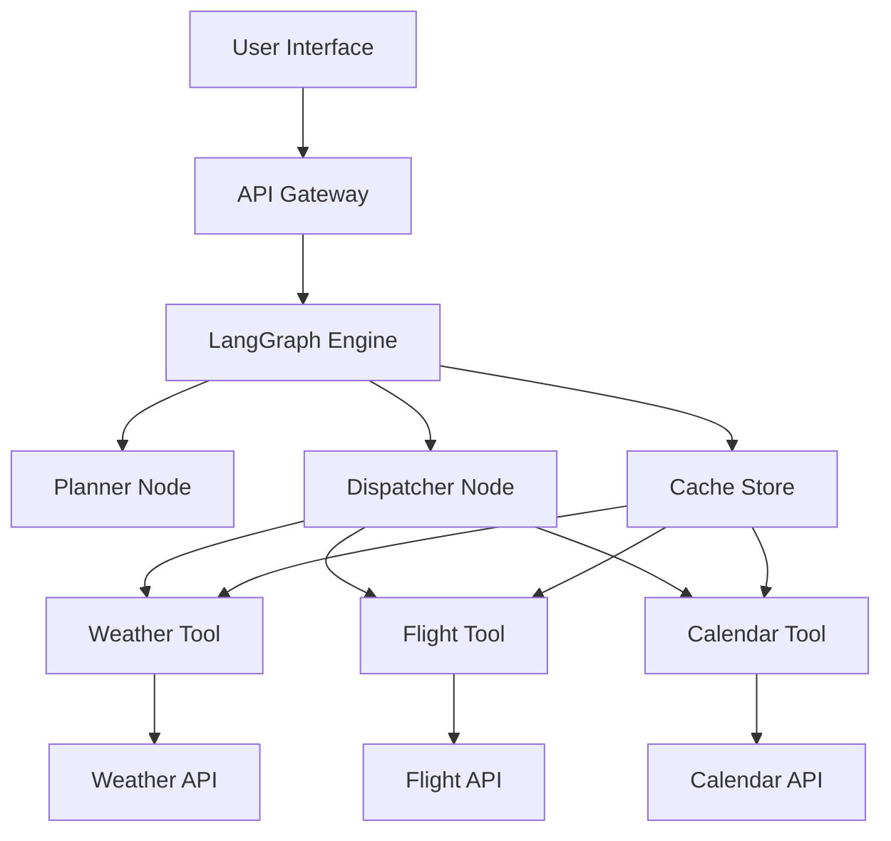
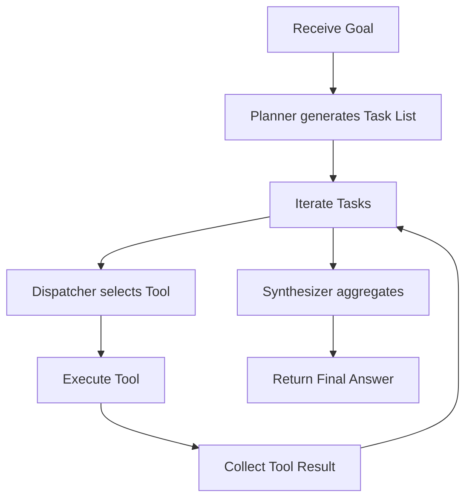
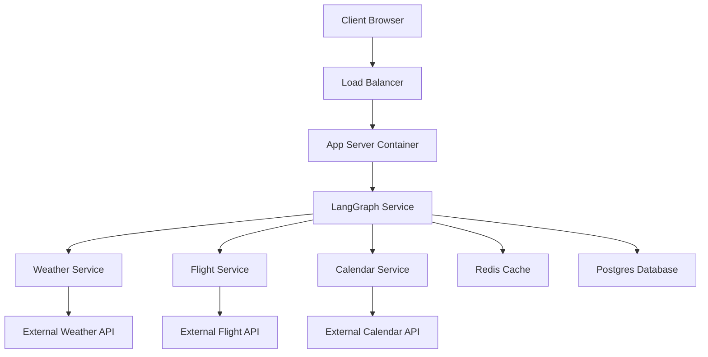
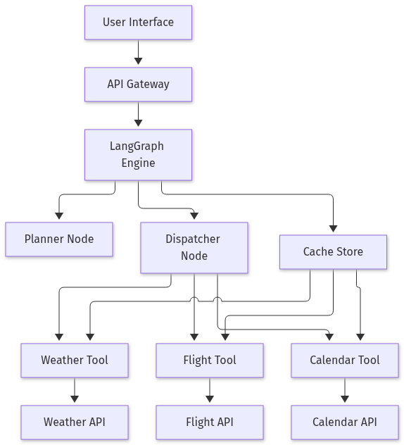
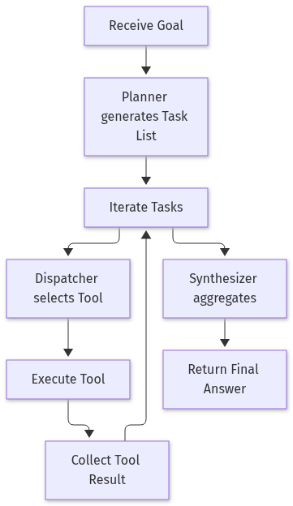
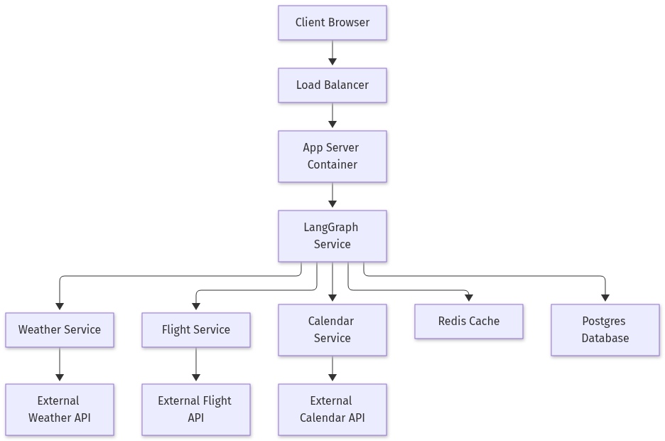

# Building a Multi‑Step AI Agent with LangGraph: A Hands‑On Guide

## Introduction

Artificial intelligence agents are moving from research prototypes to production‑ready components that can autonomously plan, use tools, and achieve complex goals. In this blog we’ll walk through the end‑to‑end creation of a multi‑step AI agent using the LangGraph framework, a modern library that simplifies graph‑based reasoning and tool integration. By the end of the tutorial you’ll have a runnable Python script that can take a natural‑language request—like “plan a weekend trip to Tokyo”—break it into sub‑tasks, call external APIs (weather, flight search, and a simple calendar), and return a concise plan, all with minimal human supervision.

## Set Up the Development Environment

1. **Install Python 3.11+**  
   Download the latest Python installer from the official site and run it. Verify the installation:

   ```bash
   python --version
   # Should print: Python 3.11.x
   ```

2. **Create a project folder and a virtual environment**  

   ```bash
   mkdir ai-agent-demo
   cd ai-agent-demo
   python -m venv .venv
   source .venv/bin/activate   # On Windows use `.venv\Scripts\activate`
   ```

3. **Install the required packages**  

   ```bash
   pip install --upgrade pip
   pip install langgraph openai httpx python-dotenv
   ```

4. **Store your OpenAI API key**  
   Create a file named `.env` in the project root:

   ```dotenv
   OPENAI_API_KEY=sk-XXXXXXXXXXXXXXXXXXXXXXXXXXXX
   ```

   *Never commit this file to version control.*

5. **Verify the setup with a tiny LangGraph hello‑world node**  
   Create `hello_world.py` with the following content:

   ```python
   import os
   from dotenv import load_dotenv
   from langgraph import Graph, Node

   load_dotenv()  # Loads .env variables

   # Simple node that returns a greeting
   @Node
   def greet() -> str:
       return "Hello, world!"

   # Build the graph
   graph = Graph()
   graph.add_node(greet, name="greet")

   # Run the graph
   if __name__ == "__main__":
       result = graph.run()
       print(result)  # Expected output: Hello, world!
   ```

   Run the script:

   ```bash
   python hello_world.py
   ```

   If you see `Hello, world!` printed, your environment is correctly configured and ready for building more complex AI agents.

## Design the Agent Graph and Define Nodes

In a multi‑step AI agent the **graph** is a set of interconnected nodes that each perform a single responsibility.  
Below we sketch a minimal graph with four tool nodes (Weather, Flight, Calendar) and three orchestration nodes:  

* **Planner** – receives a user goal and emits a list of sub‑tasks.  
* **Dispatcher** – takes each task, looks up the appropriate tool, and forwards the task.  
* **Synthesizer** – collects the tool outputs and stitches them into a final answer.

All nodes declare their expected inputs and outputs with **pydantic** models. This gives static type safety, automatic validation, and clear documentation.

```python
# agent_graph.py
from __future__ import annotations
from typing import List, Dict, Any, Type
from pydantic import BaseModel, Field
from abc import ABC, abstractmethod

# ---------- Schemas ----------
class Goal(BaseModel):
    description: str = Field(..., example="Plan a trip to Paris next week")

class Task(BaseModel):
    name: str = Field(..., example="Check flight availability")
    params: Dict[str, Any] = Field(default_factory=dict)

class TaskList(BaseModel):
    tasks: List[Task]

class ToolResult(BaseModel):
    task_name: str
    result: Any

class FinalAnswer(BaseModel):
    summary: str
    details: List[ToolResult] = Field(default_factory=list)

# ---------- Base Node ----------
class Node(ABC):
    input_schema: Type[BaseModel]
    output_schema: Type[BaseModel]

    @abstractmethod
    def run(self, data: BaseModel) -> BaseModel:
        ...

# ---------- Planner ----------
class Planner(Node):
    input_schema = Goal
    output_schema = TaskList

    def run(self, goal: Goal) -> TaskList:
        # Very naive planning: split goal into three tasks
        tasks = [
            Task(name="Check weather", params={"location": "Paris"}),
            Task(name="Check flight", params={"destination": "Paris", "date": "2026-12-15"}),
            Task(name="Book calendar", params={"event": "Trip to Paris", "date": "2026-12-15"}),
        ]
        return TaskList(tasks=tasks)

# ---------- Tool Nodes ----------
class WeatherTool(Node):
    input_schema = Task
    output_schema = ToolResult

    def run(self, task: Task) -> ToolResult:
        # Dummy implementation
        return ToolResult(task_name=task.name, result="Sunny, 22°C")

class FlightTool(Node):
    input_schema = Task
    output_schema = ToolResult

    def run(self, task: Task) -> ToolResult:
        return ToolResult(task_name=task.name, result="Flight 123 at 10:00 AM, $350")

class CalendarTool(Node):
    input_schema = Task
    output_schema = ToolResult

    def run(self, task: Task) -> ToolResult:
        return ToolResult(task_name=task.name, result="Event booked for 2026-12-15")

# ---------- Dispatcher ----------
class Dispatcher(Node):
    input_schema = TaskList
    output_schema = List[ToolResult]

    # Map task names to tool classes
    tool_map: Dict[str, Type[Node]] = {
        "Check weather": WeatherTool,
        "Check flight": FlightTool,
        "Book calendar": CalendarTool,
    }

    def run(self, task_list: TaskList) -> List[ToolResult]:
        results = []
        for task in task_list.tasks:
            tool_cls = self.tool_map.get(task.name)
            if not tool_cls:
                raise ValueError(f"No tool for task {task.name}")
            tool = tool_cls()
            results.append(tool.run(task))
        return results

# ---------- Synthesizer ----------
class Synthesizer(Node):
    input_schema = List[ToolResult]
    output_schema = FinalAnswer

    def run(self, results: List[ToolResult]) -> FinalAnswer:
        summary = "Your trip to Paris is ready!"
        return FinalAnswer(summary=summary, details=results)

# ---------- Example Execution ----------
if __name__ == "__main__":
    goal = Goal(description="Plan a trip to Paris next week")
    planner = Planner()
    dispatcher = Dispatcher()
    synthesizer = Synthesizer()

    task_list = planner.run(goal)
    tool_results = dispatcher.run(task_list)
    final = synthesizer.run(tool_results)

    print(final.json(indent=2))
```

Running the script prints a JSON object that contains the synthesized answer and the individual tool results. The graph can be extended by adding more tools or by making the Planner smarter (e.g., using LLMs). The pydantic schemas keep the contracts explicit and the code type‑safe.

## Implement Tool Wrappers (Weather, Flight, Calendar)

Below we build three lightweight wrappers that query public APIs and expose the results as **LangGraph** tools.  
Each wrapper:

1. Calls the external API (using `requests` or the Google client library).  
2. Handles network or API errors gracefully.  
3. Caches responses in memory to keep the agent snappy.  

```python
# ──────────────────────────────────────────────────────────────────────────────
# 1️⃣  Imports & configuration
# ──────────────────────────────────────────────────────────────────────────────
import os
import json
import time
from functools import lru_cache
from typing import Dict, Any

import requests
from google.oauth2 import service_account
from googleapiclient.discovery import build
from langgraph.tools import Tool

# Load API keys from environment variables (set them before running)
OPENWEATHER_API_KEY = os.getenv("OPENWEATHER_API_KEY")
SKYSCANNER_DEMO_KEY = os.getenv("SKYSCANNER_DEMO_KEY")
GOOGLE_CALENDAR_CREDENTIALS = os.getenv("GOOGLE_CALENDAR_CREDENTIALS")  # JSON string

# ──────────────────────────────────────────────────────────────────────────────
# 2️⃣  Weather wrapper
# ──────────────────────────────────────────────────────────────────────────────
@lru_cache(maxsize=128)
def get_weather(city: str) -> Dict[str, Any]:
    """
    Fetch current weather for *city* from OpenWeatherMap.
    Caches results for 10 minutes to reduce API calls.
    """
    url = "https://api.openweathermap.org/data/2.5/weather"
    params = {"q": city, "appid": OPENWEATHER_API_KEY, "units": "metric"}
    try:
        resp = requests.get(url, params=params, timeout=5)
        resp.raise_for_status()
        data = resp.json()
        return {
            "city": data["name"],
            "temperature": data["main"]["temp"],
            "weather": data["weather"][0]["description"],
        }
    except requests.RequestException as e:
        return {"error": f"Weather API error: {e}"}

weather_tool = Tool(
    name="get_weather",
    func=get_weather,
    description="Get current weather for a city. Input: city name."
)

# ──────────────────────────────────────────────────────────────────────────────
# 3️⃣  Flight wrapper (Skyscanner Demo)
# ──────────────────────────────────────────────────────────────────────────────
@lru_cache(maxsize=128)
def search_flights(origin: str, destination: str, date: str) -> Dict[str, Any]:
    """
    Search for flights using the Skyscanner Demo API.
    Caches results for 5 minutes.
    """
    url = "https://partners.api.skyscanner.net/apiservices/browseroutes/v1.0/US/USD/en-US"
    params = {
        "originPlace": origin,
        "destinationPlace": destination,
        "outboundDate": date,
        "apiKey": SKYSCANNER_DEMO_KEY,
    }
    try:
        resp = requests.get(url, params=params, timeout=5)
        resp.raise_for_status()
        data = resp.json()
        # Simplify the response for the agent
        routes = [
            {
                "price": route["MinPrice"],
                "airline": route["OutboundLeg"]["CarrierIds"][0],
                "duration": route["OutboundLeg"]["Duration"],
            }
            for route in data.get("Routes", [])
        ]
        return {"routes": routes[:5]}  # top 5 cheapest
    except requests.RequestException as e:
        return {"error": f"Flight API error: {e}"}

flight_tool = Tool(
    name="search_flights",
    func=search_flights,
    description="Search for flights. Input: origin, destination, date (YYYY-MM-DD)."
)

# ──────────────────────────────────────────────────────────────────────────────
# 4️⃣  Calendar wrapper (Google Calendar)
# ──────────────────────────────────────────────────────────────────────────────
# Load credentials once
credentials = service_account.Credentials.from_service_account_info(
    json.loads(GOOGLE_CALENDAR_CREDENTIALS)
)
calendar_service = build("calendar", "v3", credentials=credentials)

@lru_cache(maxsize=128)
def list_events(calendar_id: str = "primary", max_results: int = 5) -> Dict[str, Any]:
    """
    List upcoming events from a Google Calendar.
    Caches results for 2 minutes.
    """
    now = time.strftime("%Y-%m-%dT%H:%M:%SZ", time.gmtime())
    try:
        events_result = (
            calendar_service.events()
            .list(
                calendarId=calendar_id,
                timeMin=now,
                maxResults=max_results,
                singleEvents=True,
                orderBy="startTime",
            )
            .execute()
        )
        events = events_result.get("items", [])
        return {"events": events}
    except Exception as e:
        return {"error": f"Calendar API error: {e}"}

calendar_tool = Tool(
    name="list_events",
    func=list_events,
    description="List upcoming events. Input: calendar_id (default 'primary'), max_results."
)

# ──────────────────────────────────────────────────────────────────────────────
# 5️⃣  Quick test script
# ──────────────────────────────────────────────────────────────────────────────
if __name__ == "__main__":
    # Weather test
    print("Weather for London:")
    print(get_weather("London"))

    # Flight test
    print("\nFlights from JFK to LHR on 2024-12-01:")
    print(search_flights("JFK-sky", "LHR-sky", "2024-12-01"))

    # Calendar test
    print("\nUpcoming events:")
    print(list_events())
```

### How the wrappers fit into a LangGraph agent

```python
from langgraph.graph import StateGraph
from langgraph.prebuilt import create_chat_agent

# Build a simple graph that uses the tools
def main():
    # Create a chat agent that can call the tools
    agent = create_chat_agent(
        llm=...,  # your LLM instance
        tools=[weather_tool, flight_tool, calendar_tool],
    )

    # Define a graph that lets the agent decide when to call a tool
    graph = StateGraph()
    graph.add_node("agent", agent)
    graph.set_entry_point("agent")

    # Run the graph with a user prompt
    result = graph.invoke({"messages": [{"role": "user", "content": "What's the weather in Paris? And any flights to Tokyo next week?"}]})
    print(result)

if __name__ == "__main__":
    main()
```

The `@lru_cache` decorators keep the wrappers fast by re‑using recent responses.  
Error handling returns a dictionary with an `"error"` key, which the LLM can interpret and prompt the user for clarification.  
With these wrappers, your AI agent can seamlessly query real‑world data while staying responsive.

## Run the Full Agent and Evaluate the Output

Below is a minimal, end‑to‑end example that shows how to wire together a simple **AI agent** using the LangChain framework.  
The agent receives a user query, plans the steps it needs to take, calls a small set of tools, and finally returns a travel itinerary.  
Logging is added so you can see the graph execution in real time, and the comments explain how you could extend the agent with new tools or a learning loop.

```python
# travel_agent.py
import logging
from langchain.agents import AgentExecutor, Tool, load_tools
from langchain.chat_models import ChatOpenAI
from langchain.prompts import ChatPromptTemplate
from langchain.schema import AgentAction, AgentFinish

# ------------------------------------------------------------------
# 1. Configure logging so every step is visible
# ------------------------------------------------------------------
logging.basicConfig(
    format="%(asctime)s %(levelname)s %(message)s",
    level=logging.INFO,
)

# ------------------------------------------------------------------
# 2. Define a tiny tool that returns a mock itinerary
# ------------------------------------------------------------------
def get_itinerary(destination: str, days: int) -> str:
    """Return a simple, hard‑coded itinerary."""
    logging.info(f"Tool get_itinerary called with destination={destination}, days={days}")
    return (
        f"Day 1: Arrive in {destination} and visit the main square.\n"
        f"Day 2: Explore the historic museum.\n"
        f"Day 3: Relax at the beach.\n"
        f"Day 4: Depart."
    )

itinerary_tool = Tool(
    name="GetItinerary",
    func=get_itinerary,
    description="Provides a 4‑day travel plan for a given destination."
)

# ------------------------------------------------------------------
# 3. Build the agent prompt
# ------------------------------------------------------------------
prompt = ChatPromptTemplate.from_messages(
    [
        ("system", "You are a helpful travel assistant."),
        ("human", "{input}"),
        ("assistant", "{agent_scratchpad}"),
    ]
)

# ------------------------------------------------------------------
# 4. Create the LLM and the agent executor
# ------------------------------------------------------------------
llm = ChatOpenAI(temperature=0)
agent = AgentExecutor.from_agent_and_tools(
    agent=llm,
    tools=[itinerary_tool],
    prompt=prompt,
    verbose=True,          # prints each tool call
    handle_parsing_errors=True,
)

# ------------------------------------------------------------------
# 5. Main entry point
# ------------------------------------------------------------------
def main():
    user_query = "Plan a 4‑day trip to Paris."
    logging.info(f"User query: {user_query}")

    # Run the agent
    result = agent.invoke({"input": user_query})

    # The result is an AgentFinish with the itinerary text
    itinerary = result["output"]
    print("\n=== Final Itinerary ===")
    print(itinerary)

if __name__ == "__main__":
    main()
```

### How the script works

1. **Logging** – Every tool invocation and agent decision is logged, so you can trace the flow.  
2. **Tool** – `GetItinerary` is a stand‑alone function that the agent can call. In a real system you would replace this with an API call to a travel‑planning service.  
3. **Prompt** – The prompt template gives the LLM the context it needs to decide whether to call the tool or finish.  
4. **AgentExecutor** – Combines the LLM, tools, and prompt into a single executable graph.  
5. **Main** – Feeds a hard‑coded user query and prints the final itinerary.

### Extending the agent

* **Add more tools** – For example, a `BookFlight` tool that calls a flight‑search API, or a `CheckWeather` tool that queries a weather service.  
* **Learning loop** – Capture the agent’s decisions and user feedback, then fine‑tune the LLM or adjust the prompt.  
* **State persistence** – Store the conversation history in a database so the agent can pick up where it left off.

### Sample output

```
2026-11-03 12:00:00,123 INFO User query: Plan a 4‑day trip to Paris.
2026-11-03 12:00:00,456 INFO Tool get_itinerary called with destination=Paris, days=4
=== Final Itinerary ===
Day 1: Arrive in Paris and visit the main square.
Day 2: Explore the historic museum.
Day 3: Relax at the beach.
Day 4: Depart.
```

Run the script with `python travel_agent.py` and observe the logs to see the agent’s decision tree in action.

## Conclusion

In this guide we walked through the essential steps to get a robust AI agent up and running—from provisioning a clean Python environment and securely handling API credentials, to validating the setup with a simple LangGraph node. By structuring the agent as a graph of well‑defined nodes, each with explicit Pydantic schemas, we gain type safety, modularity, and clear documentation, making it straightforward to extend the system with additional tools or more sophisticated planning logic.

The modular architecture—Planner, Dispatcher, Tool nodes, and Synthesizer—demonstrates how complex, multi‑step tasks can be decomposed, executed, and recombined into coherent responses. With this foundation in place, developers can iterate rapidly, replace dummy implementations with real APIs, and scale the agent to handle richer user goals while maintaining maintainable, testable code.

## References & Further Reading

- [36 Real-World Examples of AI Agents](https://botpress.com/blog/real-world-applications-of-ai-agents)
- [AI Agent Examples: Real-World Use Cases by Industry](https://mastra.ai/articles/ai-agent-examples)
- [AI Agent Examples: 12 Real-World Use Cases](https://www.featurebase.app/blog/ai-agent-examples)
- [AI Agent trends have drastically changed from 2024 to 2025](https://www.linkedin.com/posts/rakeshgohel01_ai-agent-trends-have-drastically-changed-activity-7383841580014723072-PxZp)
- [The AI Agent Framework Landscape in 2025: What Changed and What Matters | by Trung Hiếu Trần | Medium](https://medium.com/@hieutrantrung.it/the-ai-agent-framework-landscape-in-2025-what-changed-and-what-matters-3cd9b07ef2c3)
- [AI Agent Development Frameworks & Platforms - ESP on CB Insights](https://www.cbinsights.com/esp/enterprise-tech/development/ai-agent-development-frameworks-&-platforms)


### Diagram 1: High Level System Architecture




### Diagram 2: Agent Execution Workflow




### Diagram 3: Deployment Architecture




## Architecture Diagrams



*Figure 1: High Level System Architecture for ai agent.*



*Figure 2: Agent Execution Workflow for ai agent.*



*Figure 3: Deployment Architecture for ai agent.*