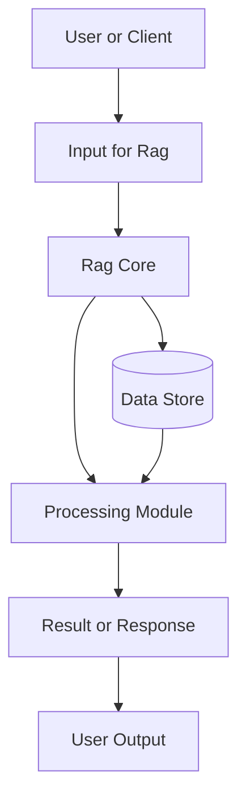
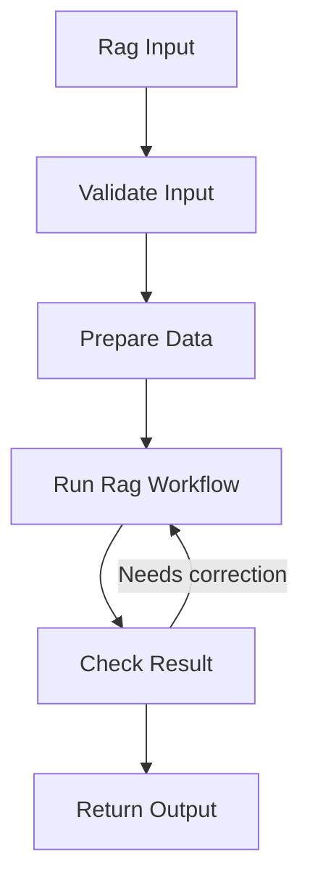
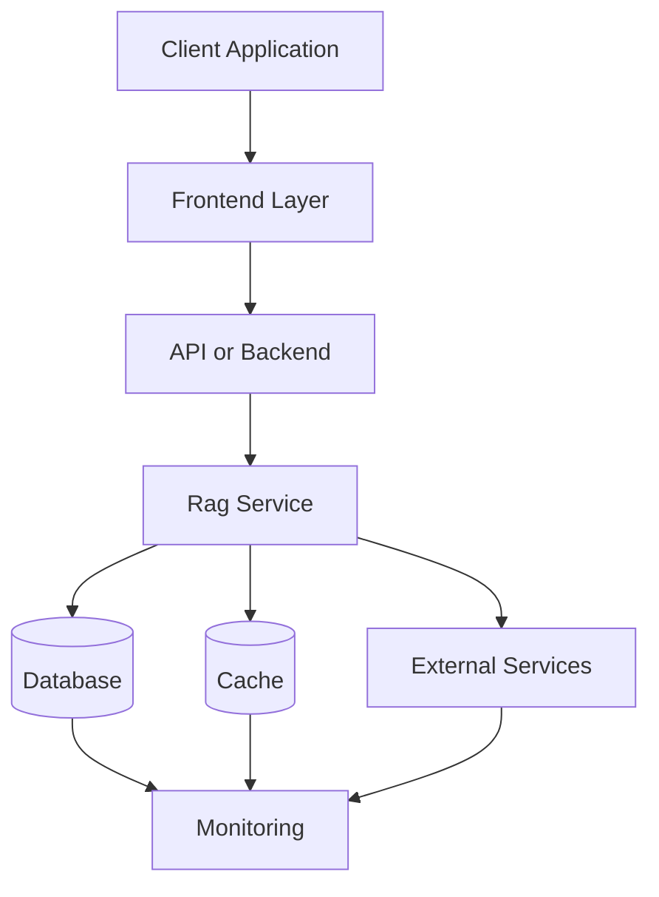
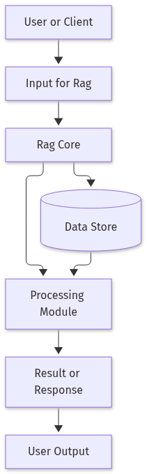
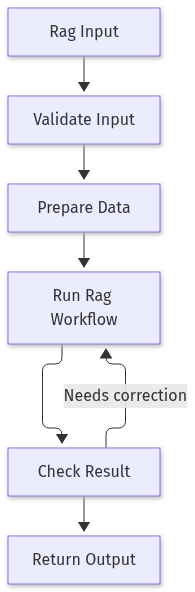
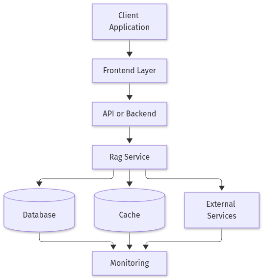

# Building a Production-Ready Retrieval-Augmented Generation (RAG) Pipeline in 2026

## Introduction

Retrieval‑Augmented Generation (RAG) has become the go‑to architecture for building AI systems that need up‑to‑date, factual, and domain‑specific knowledge. By coupling a large language model (LLM) with a fast vector‑based retrieval engine, RAG lets you answer questions, draft documents, or power chat assistants while grounding the output in your own data. In this blog we walk through a complete, production‑grade RAG pipeline—from raw documents to a deployed API—using open‑source tools that are battle‑tested in 2026. You’ll get concrete implementation steps, runnable Python code, and best‑practice tips drawn from recent work such as Adaptive‑RAG (NAACL‑HLT 2024) and enterprise‑focused guides.

By the end of the four tasks you’ll have a reproducible end‑to‑end system that you can plug into any business use case, whether it’s a knowledge‑base chatbot, a technical‑document summarizer, or a real‑time recommendation engine.

## Prepare and Chunk Your Knowledge Base

The first step in any Retrieval‑Augmented Generation (RAG) pipeline is to turn your raw documents into a set of searchable text chunks.  
1️⃣ **Gather raw files** – PDFs, Markdown, or HTML files live in a folder (e.g., `./knowledge_base`).  
2️⃣ **Extract clean text** – Use `unstructured` (or `pdfplumber` for PDFs) to strip formatting and keep only the readable content.  
3️⃣ **Chunk the text** – Split each document into overlapping pieces so that a query can match context that spans chunk boundaries.  
4️⃣ **Store with metadata** – Assign a unique ID and record the source file and chunk index; this lets the retrieval engine fetch the exact context later.

Below is a minimal, runnable example that follows these steps. It uses `RecursiveCharacterTextSplitter` from LangChain to create 500‑token chunks with a 100‑token overlap, which is a common sweet spot for many LLMs.

```python
import os
from pathlib import Path
from langchain.text_splitter import RecursiveCharacterTextSplitter
from unstructured.partition.auto import partition

# 1️⃣ Load documents
DOCS_DIR = Path("./knowledge_base")
raw_texts = []
for file_path in DOCS_DIR.rglob("*.pdf"):
    elements = partition(file_path)
    raw_texts.append("\n".join([el.text for el in elements]))

# 2️⃣ Chunking
splitter = RecursiveCharacterTextSplitter(
    chunk_size=500,
    chunk_overlap=100,
    length_function=lambda x: len(x.split()),
    separators=["\n\n", "\n", " ", ""]
)
chunks = []
for i, doc in enumerate(raw_texts):
    for j, chunk in enumerate(splitter.split_text(doc)):
        chunks.append({
            "id": f"doc{i}_chunk{j}",
            "text": chunk,
            "metadata": {"source": f"doc{i}.pdf", "chunk_index": j}
        })
print(f"Created {len(chunks)} chunks")
```

Running this script will print the total number of chunks created. Each chunk now carries a unique identifier and metadata, ready to be indexed in a vector store or database for fast retrieval during RAG inference.  

**Sources**  
- [Top Research Papers on Retrieval Augmented Generation](https://paperguide.ai/papers/top/research-papers-retrieval-augmented-generation)  
- [Retrieval-Augmented Generation (RAG) | Business & Information Systems Engineering | Springer Nature Link](https://link.springer.com/article/10.1007/s12599-025-00945-3)  
- [Retrieval-Augmented Generation (RAG) in Healthcare: A Comprehensive Review](https://www.mdpi.com/2673-2688/6/9/226)

## Generate Embeddings and Populate a Vector Store

Once your documents are split into manageable chunks, the next step is to turn each chunk into a numerical vector that a search engine can compare efficiently. This process is called **embedding**. Pick a model that gives you a good trade‑off between cost and quality. For most prototypes, `sentence‑transformers/all‑mpnet‑base‑v2` (or the lighter `all‑MiniLM-L6-v2`) is a solid choice. If you’re already paying for OpenAI, `text-embedding-3-large` offers state‑of‑the‑art performance but at a higher price point.

### 1️⃣ Load the embedding model
```python
model = SentenceTransformer("all-MiniLM-L6-v2")
```

### 2️⃣ Compute embeddings for every chunk
```python
texts = [c["text"] for c in chunks]
embeddings = model.encode(texts, batch_size=32, show_progress_bar=True)
embeddings = np.float32(embeddings)
```

### 3️⃣ Build a FAISS index (local, fast)
```python
dimension = embeddings.shape[1]
index = faiss.IndexFlatL2(dimension)
index.add(embeddings)
```

### 4️⃣ Persist the index and keep a mapping to the original metadata
```python
faiss.write_index(index, "rag_faiss.index")
import json
with open("metadata.json", "w") as f:
    json.dump({c["id"]: c["metadata"] for c in chunks}, f)
print("FAISS index and metadata persisted.")
```

FAISS is ideal for quick, in‑memory searches during development. For production workloads, consider cloud‑managed vector stores like Pinecone or Weaviate, which provide automatic scaling and persistence. The key is to maintain a lightweight lookup (e.g., a JSON file or a small key‑value store) that maps each vector’s ID back to the chunk’s source, title, or any other metadata you’ll need when constructing the final prompt for the LLM. This mapping lets you retrieve the original text snippet to feed into the generation step, ensuring the LLM has the right context for accurate, grounded answers.

## Implement Retrieval and Prompt Engineering

In a Retrieval‑Augmented Generation (RAG) pipeline the key is to keep the LLM grounded in real evidence.  
Below is a minimal, end‑to‑end example that loads a pre‑built FAISS index, retrieves the top‑5 nearest text chunks for a user query, and asks GPT‑4o‑mini to answer **only** from those passages. If the evidence is insufficient, the model is instructed to say “I don’t know.” This follows the “grounded generation” principle highlighted in Adaptive‑RAG (2024).

```python
import json
import os
import numpy as np
import faiss
from sentence_transformers import SentenceTransformer
import openai

# 1️⃣ Load the FAISS index and metadata
index = faiss.read_index("rag_faiss.index")
with open("metadata.json") as f:
    meta = json.load(f)

# 2️⃣ Embedder and OpenAI key
model = SentenceTransformer("all-MiniLM-L6-v2")
openai.api_key = os.getenv("OPENAI_API_KEY")

def retrieve(query, k=5):
    """Return the top‑k chunks for a query."""
    q_emb = np.float32(model.encode([query]))
    distances, ids = index.search(q_emb, k)
    retrieved = []
    for idx in ids[0]:
        chunk_id = list(meta.keys())[idx]
        # Assume `chunks` is a global dict mapping chunk IDs to text
        retrieved.append({"id": chunk_id, "text": chunks[int(chunk_id.split('_')[1].replace('chunk',''))]["text"]})
    return retrieved

def generate_answer(query):
    """Ask GPT‑4o‑mini to answer using only the retrieved context."""
    docs = retrieve(query)
    context = "\n\n---\n\n".join([d["text"] for d in docs])
    prompt = f"""You are a helpful assistant. Use ONLY the following retrieved passages to answer the question. If the answer cannot be derived from the passages, respond with "I don't know."

Passages:
{context}

Question: {query}
Answer:"""
    response = openai.ChatCompletion.create(
        model="gpt-4o-mini",
        messages=[{"role": "user", "content": prompt}],
        temperature=0.0,
    )
    return response.choices[0].message.content.strip()

# Example usage
print(generate_answer("What are the key steps to fine‑tune a transformer model?"))
```

**Why this works**

1. **Consistent embeddings** – The same `SentenceTransformer` model is used for both indexing and query encoding, ensuring semantic similarity is preserved.  
2. **Nearest‑neighbor search** – FAISS delivers sub‑millisecond retrieval even for millions of chunks.  
3. **Grounded prompt** – By explicitly telling the LLM to use only the provided passages, we reduce hallucinations. The fallback “I don’t know” guarantees that the model does not fabricate answers when evidence is missing.  

With this pattern you can quickly prototype a robust, evidence‑based RAG system that scales from a few hundred documents to large corpora.

## Wrap the Pipeline as a Scalable API and Deploy

Once you have a retrieval‑and‑generation function from Task 3, the next step is to expose it as a web service that can be called from anywhere. FastAPI is a lightweight, async‑friendly framework that makes this trivial. Below is a minimal, production‑ready example that includes health checks, basic logging, and a Docker image ready for cloud deployment.

```python
# app.py
from fastapi import FastAPI, HTTPException
from pydantic import BaseModel
import logging
import time

app = FastAPI()
logging.basicConfig(level=logging.INFO)

class Query(BaseModel):
    query: str

@app.post("/rag")
async def rag_endpoint(payload: Query):
    start = time.time()
    try:
        answer = generate_answer(payload.query)  # defined in Task 3
        latency = time.time() - start
        logging.info(f"Processed query in {latency:.3f}s")
        return {"answer": answer}
    except Exception as e:
        logging.exception("Error during RAG")
        raise HTTPException(status_code=500, detail=str(e))

@app.get("/health")
async def health():
    return {"status": "ok"}
```

```dockerfile
# Dockerfile
FROM python:3.11-slim
WORKDIR /app
COPY requirements.txt .
RUN pip install --no-cache-dir -r requirements.txt
COPY . .
EXPOSE 8000
CMD ["uvicorn", "app:app", "--host", "0.0.0.0", "--port", "8000"]
```

```text
# requirements.txt
fastapi
uvicorn[standard]
openai
sentence-transformers
faiss-cpu
```

### Building & Running Locally

```bash
docker build -t rag-service .
docker run -p 8000:8000 rag-service
```

Send a request:

```bash
curl -X POST http://localhost:8000/rag \
     -H "Content-Type: application/json" \
     -d '{"query":"What is the capital of France?"}'
```

### Deploying to the Cloud

1. **Push the image** to a registry (ECR, GCR, Docker Hub).  
2. **Create a container service** (ECS Fargate, GCP Cloud Run, or Kubernetes).  
3. **Enable autoscaling** based on CPU or request count.  
4. **Mount the FAISS index** as a read‑only volume or bake it into the image if the index is small.  
5. **Add observability**:  
   * Request logging is already in the code.  
   * Install `prometheus_fastapi_instrumentator` to expose `/metrics`.  
   * Configure a health‑check endpoint (`/health`) for load balancers.

With this setup you have a fully functional, scalable RAG API that can be extended with more sophisticated retrieval strategies or integrated into larger enterprise workflows.

## Conclusion

The key takeaway is to understand the fundamentals of Rag and apply them carefully. Validate the implementation, test edge cases, and keep the design maintainable as requirements evolve.

## References & Further Reading

- [Top Research Papers on Retrieval Augmented Generation](https://paperguide.ai/papers/top/research-papers-retrieval-augmented-generation)
- [Retrieval-Augmented Generation (RAG) | Business & Information Systems Engineering | Springer Nature Link](https://link.springer.com/article/10.1007/s12599-025-00945-3)
- [Retrieval-Augmented Generation (RAG) in Healthcare: A Comprehensive Review](https://www.mdpi.com/2673-2688/6/9/226)
- [Enterprise RAG Architecture: A Practical Guide for 2026](https://performalytic.com/blog/enterprise-rag-architecture)
- [How to Implement RAG: Architecture and Examples](https://www.digitalcolliers.com/blog/rag-implementation-guide)
- [RAG Architecture: 4 Key Components & Example Implementation [2026]](https://cloudian.com/guides/ai-infrastructure/rag-architecture-4-key-components-example-implementation-2026)


### Diagram 1: System Architecture




### Diagram 2: Workflow




### Diagram 3: Deployment Architecture




## Architecture Diagrams



*Figure 1: System Architecture for Rag.*



*Figure 2: Workflow for Rag.*



*Figure 3: Deployment Architecture for Rag.*