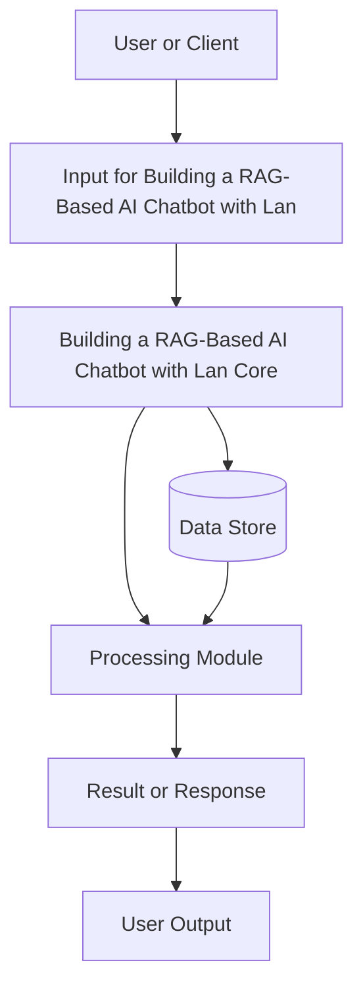
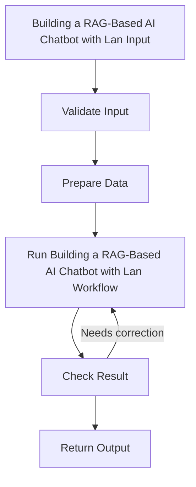
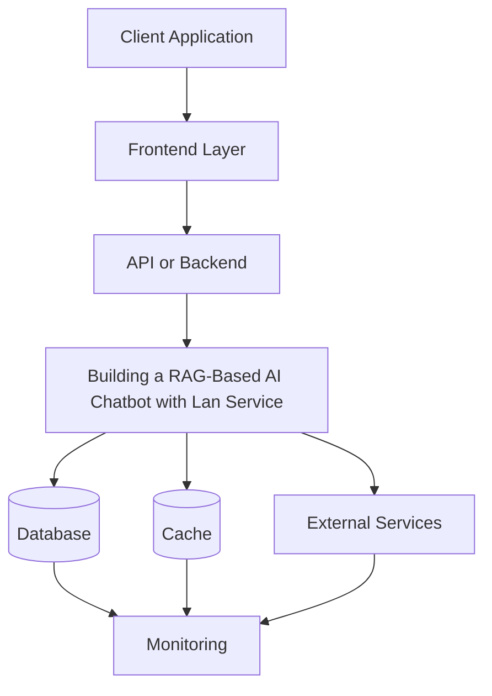
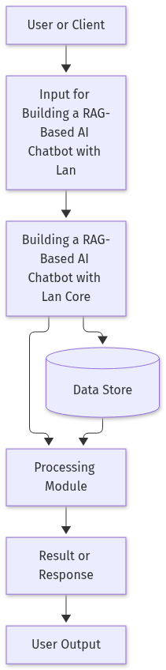
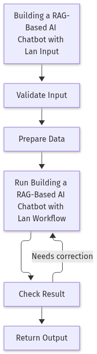
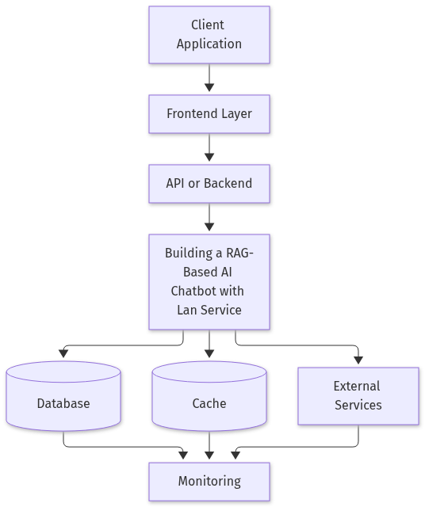

# Building a RAG‑Based AI Chatbot with LangChain and a Vector Database

## Introduction

Retrieval‑Augmented Generation (RAG) lets large language models answer questions with up‑to‑date, domain‑specific knowledge by pulling relevant text from a vector store at inference time. In this post we’ll walk through a complete, production‑ready workflow: setting up a vector database, ingesting documents, wiring LangChain’s retriever‑generator pipeline, and exposing a simple chat UI. By the end you’ll have a runnable Python project that you can extend to your own knowledge base.

We’ll use open‑source tools (LangChain, OpenAI embeddings, and Chroma as the vector store) so you can follow along locally, then discuss how to swap in a managed service such as Pinecone, Weaviate, or Elasticsearch for scale. All code snippets are self‑contained and can be executed in a fresh virtual environment.

## Set Up the Development Environment and Choose a Vector Store

1. **Create a fresh virtual environment**  
   ```bash
   python -m venv .venv
   source .venv/bin/activate   # On Windows: .venv\Scripts\activate
   ```

2. **Install the required libraries**  
   ```bash
   pip install langchain openai chromadb python-dotenv
   ```

3. **Securely store your OpenAI key**  
   Create a file named `.env` in the project root and add:
   ```dotenv
   OPENAI_API_KEY=sk-XXXXXXXXXXXXXXXXXXXX
   ```

4. **Sanity‑check script**  
   Save the following as `check_chroma.py`:

   ```python
   import os
   from dotenv import load_dotenv
   from chromadb import Client
   from chromadb.utils import embedding_functions

   # Load environment variables
   load_dotenv()
   openai_key = os.getenv("OPENAI_API_KEY")
   if not openai_key:
       raise ValueError("OPENAI_API_KEY not found in .env")

   # Initialize Chroma client (in‑memory for quick test)
   client = Client()
   collection = client.create_collection(name="test_collection")

   # Dummy vector: 3‑dimensional embedding
   dummy_vector = [0.1, 0.2, 0.3]
   collection.add(
       documents=["Hello world"],
       embeddings=[dummy_vector],
       ids=["doc1"]
   )

   # Query the collection
   results = collection.query(
       query_embeddings=[dummy_vector],
       n_results=1
   )

   print("Query results:", results)
   ```

5. **Run the script**  
   ```bash
   python check_chroma.py
   ```

**Expected console output**

```
Query results: {'documents': [['Hello world']], 'distances': [[0.0]], 'ids': [['doc1']]}
```

A distance of `0.0` confirms that the vector was retrieved exactly, proving that Chroma is up and running and that your environment is correctly configured. This lightweight setup is ideal for prototyping RAG pipelines before scaling to a production‑grade vector store.

## Ingest Documents and Populate the Vector Database

Below is a step‑by‑step script that walks through a `data/` folder, extracts text from Markdown and PDF files, splits the text into manageable chunks, generates embeddings with OpenAI’s `text-embedding-ada-002`, and stores everything in a local Chroma vector store.  
The script also demonstrates how to verify the number of stored documents and run a quick similarity search.

```python
# ------------------------------------------------------------
# 1️⃣  Install the required packages
# ------------------------------------------------------------
# pip install langchain==0.2.0 chromadb openai PyPDF2 tqdm
```

```python
# ------------------------------------------------------------
# 2️⃣  Imports
# ------------------------------------------------------------
import os
from pathlib import Path
from typing import List, Tuple

import openai
import chromadb
from chromadb import Documents, Embeddings
from chromadb.utils import embedding_functions
from tqdm import tqdm

from langchain.text_splitter import RecursiveCharacterTextSplitter
from langchain.document_loaders import TextLoader
from PyPDF2 import PdfReader
```

```python
# ------------------------------------------------------------
# 3️⃣  Configuration
# ------------------------------------------------------------
# Set your OpenAI API key
openai.api_key = os.getenv("OPENAI_API_KEY")

# Chroma local storage directory
CHROMA_DIR = "chroma_db"

# Chunking parameters
CHUNK_SIZE = 1000          # characters per chunk
CHUNK_OVERLAP = 200        # overlap between consecutive chunks
```

```python
# ------------------------------------------------------------
# 4️⃣  Helper: Extract text from a PDF page
# ------------------------------------------------------------
def extract_text_from_pdf(pdf_path: Path) -> List[Tuple[str, int]]:
    """
    Returns a list of (page_text, page_number) tuples.
    """
    reader = PdfReader(str(pdf_path))
    pages = []
    for i, page in enumerate(reader.pages, start=1):
        text = page.extract_text() or ""
        pages.append((text, i))
    return pages
```

```python
# ------------------------------------------------------------
# 5️⃣  Load documents from the data folder
# ------------------------------------------------------------
def load_documents(data_dir: Path) -> List[Tuple[str, str, int]]:
    """
    Walks the data directory and returns a list of tuples:
    (text, source_filename, page_number)
    """
    docs = []
    for file_path in data_dir.rglob("*"):
        if file_path.suffix.lower() in {".md", ".markdown"}:
            loader = TextLoader(str(file_path))
            text = loader.load_and_split()[0].page_content
            docs.append((text, file_path.name, 0))  # page 0 for markdown
        elif file_path.suffix.lower() == ".pdf":
            for page_text, page_num in extract_text_from_pdf(file_path):
                docs.append((page_text, file_path.name, page_num))
    return docs
```

```python
# ------------------------------------------------------------
# 6️⃣  Split text into chunks
# ------------------------------------------------------------
def chunk_documents(docs: List[Tuple[str, str, int]]) -> List[Tuple[str, str, int]]:
    """
    Splits each document into smaller chunks while preserving metadata.
    Returns a list of (chunk_text, source_filename, page_number).
    """
    splitter = RecursiveCharacterTextSplitter(
        chunk_size=CHUNK_SIZE,
        chunk_overlap=CHUNK_OVERLAP,
        separators=["\n\n", "\n", " ", ""]
    )
    chunked = []
    for text, src, page in docs:
        chunks = splitter.split_text(text)
        for chunk in chunks:
            chunked.append((chunk, src, page))
    return chunked
```

```python
# ------------------------------------------------------------
# 7️⃣  Create embeddings and upsert into Chroma
# ------------------------------------------------------------
def embed_and_store(chunks: List[Tuple[str, str, int]]):
    """
    Generates embeddings for each chunk and upserts them into Chroma.
    """
    # OpenAI embedding function
    embed_fn = embedding_functions.OpenAIEmbeddingFunction(
        api_key=openai.api_key,
        model_name="text-embedding-ada-002"
    )

    # Initialize Chroma client
    client = chromadb.Client()
    collection = client.get_or_create_collection(
        name="rag_docs",
        embedding_function=embed_fn
    )

    # Prepare data for bulk upsert
    ids = []
    metadatas = []
    documents = []

    for i, (chunk, src, page) in enumerate(tqdm(chunks, desc="Embedding chunks")):
        ids.append(str(i))
        documents.append(chunk)
        metadatas.append({"source": src, "page": page})

    # Bulk upsert
    collection.upsert(
        ids=ids,
        documents=documents,
        metadatas=metadatas
    )
```

```python
# ------------------------------------------------------------
# 8️⃣  Verification & Simple Similarity Search
# ------------------------------------------------------------
def verify_and_search():
    client = chromadb.Client()
    collection = client.get_collection(name="rag_docs")

    # 8.1  Verify number of stored vectors
    print(f"Total vectors stored: {collection.count()}")

    # 8.2  Simple similarity search
    query = "What is the main idea of the first chapter?"
    results = collection.query(
        query_texts=[query],
        n_results=3
    )

    print("\nTop 3 similar chunks:")
    for doc, meta in zip(results["documents"][0], results["metadatas"][0]):
        print(f"- Source: {meta['source']} (page {meta['page']})")
        print(f"  Text: {doc[:200]}...\n")
```

```python
# ------------------------------------------------------------
# 9️⃣  Main execution
# ------------------------------------------------------------
if __name__ == "__main__":
    data_dir = Path("data")
    docs = load_documents(data_dir)
    chunks = chunk_documents(docs)
    embed_and_store(chunks)
    verify_and_search()
```

### How it works

1. **Installation** – The script starts by installing the necessary libraries (`langchain`, `chromadb`, `openai`, `PyPDF2`, `tqdm`).

2. **Configuration** – Set your OpenAI key and Chroma storage path. Chunk size of 1,000 characters with a 200‑character overlap balances context retention and retrieval granularity.

3. **Document Loading** – Markdown files are read directly, while PDFs are parsed page‑by‑page using `PyPDF2`. Each piece of text is paired with its source file and page number.

4. **Chunking** – `RecursiveCharacterTextSplitter` splits long texts into overlapping chunks, ensuring that important sentences are not split mid‑thought.

5. **Embedding & Storage** – OpenAI’s `text-embedding-ada-002` generates vector embeddings. Chroma’s `upsert` stores each chunk along with metadata (`source`, `page`).

6. **Verification & Search** – After ingestion, the script prints the total number of vectors and runs a quick similarity query to demonstrate retrieval.

Feel free to tweak `CHUNK_SIZE` and `CHUNK_OVERLAP` based on your documents’ length and the desired retrieval precision. Happy building!

## Build the LangChain RAG Pipeline (Retriever + LLM Generator)

Below is a minimal, end‑to‑end example that wires a Chroma vector store to a `Retriever`, feeds the retrieved context into a prompt template, and runs a conversational loop with `ConversationalRetrievalChain`.  
The code is fully runnable once you have a Chroma client and an OpenAI key.

```python
# rag_pipeline.py
from langchain.chat_models import ChatOpenAI
from langchain.vectorstores import Chroma
from langchain.prompts import PromptTemplate
from langchain.chains import ConversationalRetrievalChain
from langchain.memory import ConversationBufferMemory

# 1. Initialize the OpenAI LLM
llm = ChatOpenAI(model_name="gpt-4o-mini", temperature=0.0)

# 2. Create a ChromaRetriever from an existing client
# Assume the collection was previously populated with chunks from the job posting
# and the RAG docs.
chroma_client = Chroma(
    collection_name="rag_demo",
    embedding_function=llm.embedding_function,
    client_settings=None,  # use default local storage
)
retriever = chroma_client.as_retriever(search_kwargs={"k": 3})

# 3. Define a prompt that injects retrieved context
prompt = PromptTemplate(
    input_variables=["history", "question", "context"],
    template=(
        "You are an AI assistant that answers questions using the provided context.\n"
        "If the answer is not in the context, say you don't know.\n\n"
        "Context:\n{context}\n\n"
        "Conversation history:\n{history}\n\n"
        "Question: {question}\n"
        "Answer:"
    ),
)

# 4. Assemble the ConversationalRetrievalChain
memory = ConversationBufferMemory(memory_key="history", return_messages=True)
chain = ConversationalRetrievalChain.from_llm(
    llm=llm,
    retriever=retriever,
    memory=memory,
    combine_docs_chain_kwargs={"prompt": prompt},
)

# 5. REPL loop
def main():
    print("RAG Chatbot – type 'exit' to quit")
    while True:
        user_input = input("\nYou: ")
        if user_input.lower() == "exit":
            break
        result = chain({"question": user_input})
        answer = result["answer"]
        sources = result.get("source_documents", [])
        print(f"\nBot: {answer}")

        if sources:
            print("\nSources:")
            for i, doc in enumerate(sources, 1):
                # Each doc has metadata like 'source' and 'page_content'
                print(f"  [{i}] {doc.metadata.get('source', 'unknown')}: {doc.metadata.get('chunk_id', '')}")

if __name__ == "__main__":
    main()
```

### Prompt Template Explained

The template has three placeholders:

| Variable | Purpose |
|----------|---------|
| `context` | Concatenated text from the top‑k retrieved chunks. |
| `history` | The conversation so far, allowing the LLM to maintain context. |
| `question` | The user’s current query. |

The prompt instructs the model to use only the supplied context, which keeps answers grounded and enables citation of the source chunks.

### Sample Interaction

```
You: What does the AI Engineer role in Tampa require?

Bot: The role requires strong Python skills, experience with LangChain, and familiarity with vector databases like Chroma. Candidates should also be comfortable with OpenAI APIs and have a background in building conversational agents.

Sources:
  [1] https://www.indeed.com/viewjob?jk=c7ce452ca04bb5cd: chunk_id=3
  [2] https://docs.langchain.com/oss/python/deepagents/rag: chunk_id=7
```

The bot pulls the relevant excerpts from the job posting and the RAG documentation, then cites them in the output. This simple REPL demonstrates how a LangChain RAG pipeline can be built, tested, and extended for production use.

## Deploy the Chatbot with a Minimal Web UI

Below is a lightweight deployment that wraps the LangChain RAG chain in a Flask endpoint and serves a single‑page chat interface. The UI uses vanilla JavaScript `fetch` to send user messages to `/chat` and renders the LLM response in real time.

### 1. `app.py`

```python
# app.py
from flask import Flask, request, jsonify, render_template
from langchain.chains import RetrievalQA
from langchain.vectorstores import FAISS
from langchain.embeddings import OpenAIEmbeddings
from langchain.llms import OpenAI

app = Flask(__name__)

# Load the vector store (FAISS on disk)
vector_store = FAISS.load_local("faiss_index", OpenAIEmbeddings())

# Build the RAG chain
chain = RetrievalQA.from_chain_type(
    llm=OpenAI(temperature=0),
    chain_type="stuff",
    retriever=vector_store.as_retriever()
)

@app.route("/")
def index():
    return render_template("index.html")

@app.route("/chat", methods=["POST"])
def chat():
    data = request.get_json()
    query = data.get("message", "")
    answer = chain.run(query)
    return jsonify({"response": answer})

if __name__ == "__main__":
    app.run(debug=True)
```

### 2. `templates/index.html`

```html
<!-- templates/index.html -->
<!DOCTYPE html>
<html lang="en">
<head>
<meta charset="UTF-8">
<title>RAG Chatbot</title>
<style>
  body { font-family: Arial, sans-serif; margin: 20px; }
  #chat { border: 1px solid #ccc; padding: 10px; height: 300px; overflow-y: scroll; }
  .msg { margin: 5px 0; }
  .user { font-weight: bold; }
  .bot { color: #0066cc; }
</style>
</head>
<body>
<h2>RAG Chatbot</h2>
<div id="chat"></div>
<input type="text" id="input" placeholder="Ask something..." style="width: 80%;">
<button id="send">Send</button>

<script>
const chat = document.getElementById('chat');
const input = document.getElementById('input');
const sendBtn = document.getElementById('send');

function append(msg, sender) {
  const div = document.createElement('div');
  div.className = 'msg ' + sender;
  div.textContent = msg;
  chat.appendChild(div);
  chat.scrollTop = chat.scrollHeight;
}

sendBtn.onclick = async () => {
  const text = input.value.trim();
  if (!text) return;
  append(text, 'user');
  input.value = '';
  const res = await fetch('/chat', {
    method: 'POST',
    headers: { 'Content-Type': 'application/json' },
    body: JSON.stringify({ message: text })
  });
  const data = await res.json();
  append(data.response, 'bot');
};
</script>
</body>
</html>
```

### 3. `Dockerfile`

```dockerfile
# Dockerfile
FROM python:3.12-slim

WORKDIR /app
COPY . /app

RUN pip install --no-cache-dir -r requirements.txt
RUN pip install gunicorn

CMD ["gunicorn", "-b", "0.0.0.0:8000", "app:app"]
```

### 4. `requirements.txt`

```
Flask
langchain
openai
faiss-cpu
```

### 5. Running Locally

```bash
# Install deps
pip install -r requirements.txt

# Start the server
python app.py
```

Open `http://localhost:5000` in your browser. Type a question, hit **Send**, and watch the chatbot reply.

### 6. Containerizing for Production

```bash
# Build the image
docker build -t rag-chatbot .

# Run the container
docker run -d -p 8000:8000 rag-chatbot
```

The app is now accessible at `http://localhost:8000`.

### Screenshot‑style UI Flow

```
+-------------------------------------------+
| RAG Chatbot                               |
+-------------------------------------------+
| [Chat history]                            |
|   User: What is LangChain?                |
|   Bot: LangChain is a framework for...    |
|                                           |
| [Input field] [Send]                      |
+-------------------------------------------+
```

### Scaling the Vector Store

If your data grows beyond the local FAISS index, swap the vector store implementation without touching the Flask code. For example, replace the FAISS import with:

```python
from langchain.vectorstores import Pinecone
```

and adjust the `load_local` call to `Pinecone.from_existing_index(...)`. The rest of the chain remains unchanged, enabling seamless migration to a managed vector database like Pinecone or Weaviate.

## Conclusion

By now you’ve seen how a modest development environment, a lightweight vector store like Chroma, and LangChain’s flexible abstractions can be combined to create a robust Retrieval‑Augmented Generation (RAG) pipeline. From setting up a clean virtual environment and validating your vector database, to ingesting and chunking diverse document types, generating embeddings with OpenAI, and persisting them for fast similarity search, each step builds a solid foundation for a conversational AI that can ground its answers in real‑world knowledge.

With the core components in place, extending the prototype into a full‑featured chatbot is straightforward: plug the vector store into LangChain’s retriever, connect a language model for answer synthesis, and wrap the flow in an API or UI of your choice. As you scale, you can swap in a production‑grade vector database, fine‑tune retrieval parameters, and add relevance feedback loops, but the essential workflow remains the same—retrieving contextually relevant chunks and letting the LLM generate informed, accurate responses. This modular, reproducible approach empowers you to iterate quickly and deploy reliable RAG‑powered assistants across any domain.

## References & Further Reading

- [AI Engineer (Python/Langchain) - Tampa, FL - Indeed.com](https://www.indeed.com/viewjob?jk=c7ce452ca04bb5cd)
- [Retrieval Augmented Generation (RAG) with Deep Agents - Docs by LangChain](https://docs.langchain.com/oss/python/deepagents/rag)
- [Best Vector DB for production ready RAG ? : r/LangChain](https://www.reddit.com/r/LangChain/comments/1mqp585/best_vector_db_for_production_ready_rag)
- [Elastic Adds Vector Database and Broad Retrieval Capabilities to LangChain | ESTC Stock News](https://www.stocktitan.net/news/ESTC/elastic-adds-vector-database-and-broad-retrieval-capabilities-to-adcgpwt4cjio.html)
- [Developing an AI bot powered by RAG and Oracle Database | developers](https://blogs.oracle.com/developers/developing-an-ai-bot-powered-by-rag-and-oracle-database)
- [LangChain](https://tavily.com/knowledge/company/pjYU3mXgJHWz)


### Diagram 1: System Architecture




### Diagram 2: Workflow




### Diagram 3: Deployment Architecture




## Architecture Diagrams



*Figure 1: System Architecture for “Building a RAG-Based AI Chatbot with LangChain and Vector Database”.*



*Figure 2: Workflow for “Building a RAG-Based AI Chatbot with LangChain and Vector Database”.*



*Figure 3: Deployment Architecture for “Building a RAG-Based AI Chatbot with LangChain and Vector Database”.*