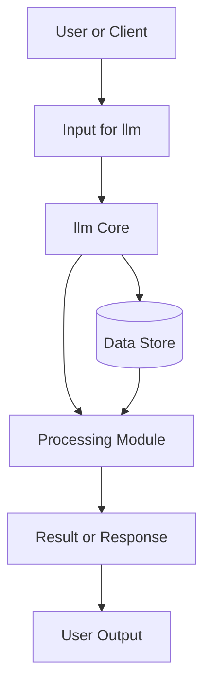
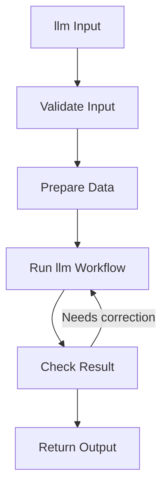
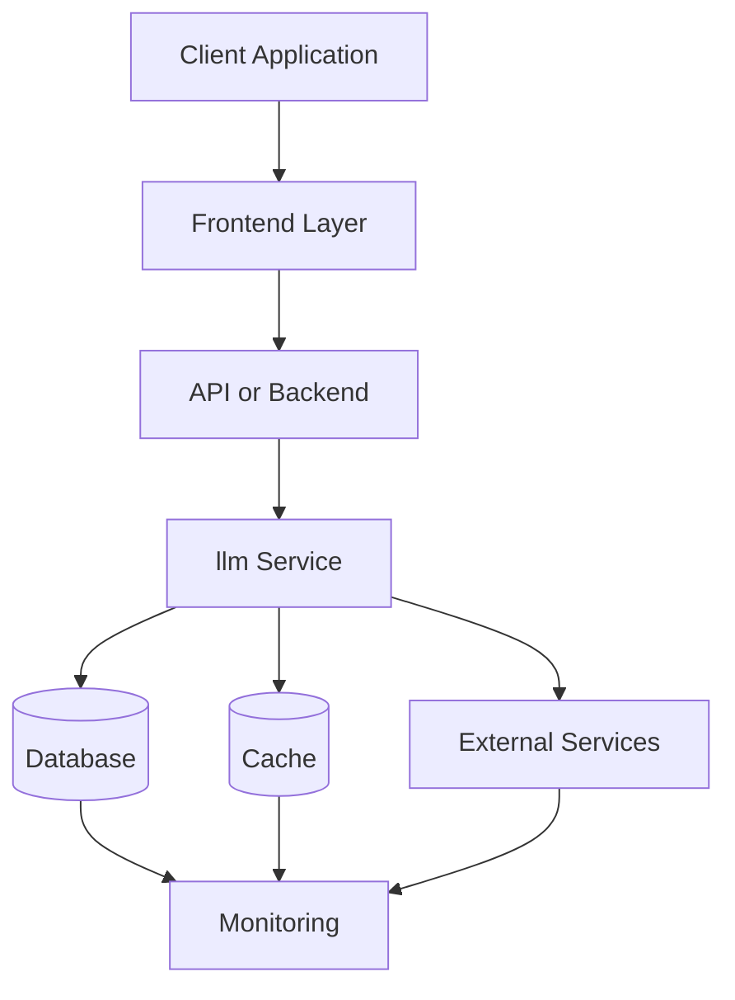
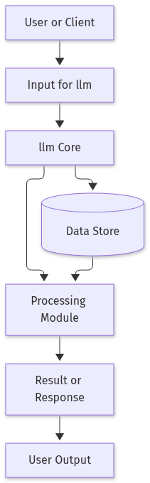
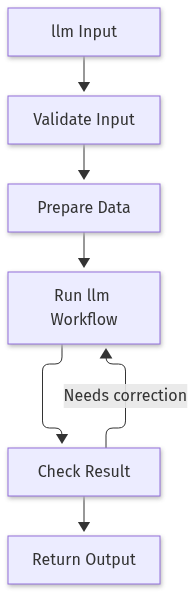
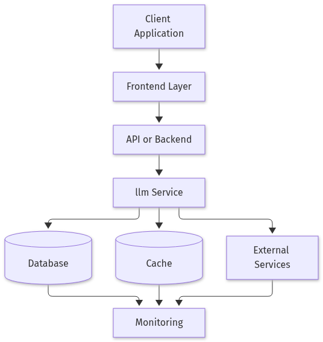

# Building a Simple Multi‑Modal LLM Pipeline with Phi‑4‑Multimodal

## Introduction

Large Language Models (LLMs) have moved beyond pure text, enabling applications that understand and generate content across modalities such as images and audio. In this blog we will walk through a practical, end‑to‑end example that shows how to set up a lightweight multi‑modal LLM (Phi‑4‑Multimodal), feed it a combined text‑image prompt, and expose the inference logic as a tiny HTTP API. The steps are deliberately minimal so you can run the code on a modest GPU (or even CPU with reduced batch size) and experiment with your own data. By the end you’ll have a reusable script that can be extended to more complex pipelines, such as document analysis, visual question answering, or product‑recommendation chatbots.

## Set up the environment and load Phi‑4‑Multimodal

Large‑language models like **Phi‑4‑Multimodal** are heavy, so a clean, isolated environment and the right dependencies make the process painless. Below is a step‑by‑step guide that works on both CPU‑only machines and GPUs.

1. **Create a virtual environment**  
   ```bash
   python -m venv llm-env
   source llm-env/bin/activate   # On Windows: llm-env\Scripts\activate
   ```

2. **Install the required packages**  
   ```bash
   pip install torch torchvision transformers accelerate pillow
   ```

3. **Pull the model from Hugging Face**  
   The model is hosted under `microsoft/phi-4-multimodal`.  
   ```bash
   # No explicit command needed – the `from_pretrained` call will download it.
   ```

4. **Load the model with the appropriate precision**  
   * `torch.float16` is optimal for GPUs (half‑precision).  
   * `torch.float32` keeps the model on CPU without precision loss.

5. **Verify the setup with a quick sanity check** – encode a dummy prompt and print the token IDs.

```python
import torch
from transformers import AutoModelForCausalLM, AutoTokenizer

# 1️⃣ Choose device
device = torch.device("cuda" if torch.cuda.is_available() else "cpu")

# 2️⃣ Load tokenizer and model
model_name = "microsoft/phi-4-multimodal"
tokenizer = AutoTokenizer.from_pretrained(model_name)
model = AutoModelForCausalLM.from_pretrained(
    model_name,
    torch_dtype=torch.float16 if device.type == "cuda" else torch.float32,
    low_cpu_mem_usage=True,
).to(device)

# 3️⃣ Sanity check – encode a short prompt
prompt = "Explain the image in one sentence."
inputs = tokenizer(prompt, return_tensors="pt").to(device)
print("Model loaded successfully! Prompt token IDs:", inputs.input_ids)
```

Running the script should print the token IDs without errors, confirming that the model and tokenizer are correctly initialized. From here you can proceed to feed actual multimodal inputs or integrate the model into a larger pipeline.

## Prepare a multimodal input (text + image)

When working with a multimodal model such as Phi‑4‑Multimodal, the image must be tokenized into visual embeddings that the same tokenizer used for text can understand. The `AutoProcessor` class from the 🤗 transformers library handles this conversion automatically, so you only need to feed it the raw image and the accompanying text.

### Step‑by‑step guide

1. **Install Pillow** – the Python Imaging Library that lets us load and manipulate images.  
   ```bash
   pip install pillow
   ```

2. **Load an example image** – you can use a local file or fetch one from the web.  
   ```python
   from PIL import Image
   import requests

   url = "https://huggingface.co/datasets/huggingface/documentation-images/resolve/main/transformers/tasks.png"
   image = Image.open(requests.get(url, stream=True).raw).convert("RGB")
   ```

3. **Create the processor** – it knows the tokenization scheme for both modalities.  
   ```python
   from transformers import AutoProcessor

   model_name = "microsoft/phi-4-multimodal"
   processor = AutoProcessor.from_pretrained(model_name)
   ```

4. **Define your textual prompt** – the question or instruction you want the model to answer.  
   ```python
   question = "What is the main topic of the diagram?"
   ```

5. **Process both modalities together** – the processor returns a dictionary of tensors ready for the model.  
   ```python
   inputs = processor(text=question, images=image, return_tensors="pt")
   print("Combined input shape:", inputs['input_ids'].shape)
   ```

The printed shape confirms that the text and image have been concatenated into a single sequence of token IDs, matching the model’s expectations. You can now feed `inputs` to the Phi‑4‑Multimodal model for inference.

## Run inference and post‑process the output

Once the multimodal tensor is ready, the next step is to feed it into the model, generate a response, and turn the raw token IDs back into human‑readable text. The following workflow uses greedy decoding for simplicity, but you can swap `do_sample=False` for beam search or temperature‑based sampling if you need more diverse outputs.

**Implementation steps**

1. **Generate** – Call `model.generate` with a maximum token budget and disable sampling.  
2. **Decode** – Convert the returned token IDs into a string with the tokenizer.  
3. **Clean** – Strip any special tokens (e.g., `<eos>`) so the output looks natural.  
4. **Measure** – Optionally wrap the call in a timer to gauge latency.

```python
import time

# 1️⃣ Generate response (greedy decoding)
start = time.perf_counter()
output_ids = model.generate(
    **inputs,
    max_new_tokens=64,
    do_sample=False,
    pad_token_id=tokenizer.eos_token_id,
)
elapsed = time.perf_counter() - start

# 2️⃣ Decode
answer = tokenizer.decode(output_ids[0], skip_special_tokens=True)
print(f"🕒 Inference time: {elapsed:.2f}s")
print("🗣 Model answer:")
print(answer)
```

**What’s happening under the hood?**

- `model.generate` runs the transformer forward pass on the input tensor, producing logits for each position.  
- With `do_sample=False`, the algorithm picks the highest‑probability token at every step (greedy).  
- `max_new_tokens` limits the length of the generated sequence, preventing runaway generation.  
- `pad_token_id` ensures that padding tokens are treated as end‑of‑sequence markers during generation.  
- `tokenizer.decode(..., skip_special_tokens=True)` converts token IDs back to text while removing artifacts like `<pad>` or `<eos>`.

This minimal pipeline gives you a quick, deterministic answer and a clear latency metric, making it ideal for prototyping or benchmarking LLM inference on your hardware.

## Wrap the pipeline in a lightweight FastAPI service

To expose the multimodal inference as a REST endpoint, we’ll build a tiny FastAPI app that accepts a multipart/form‑data request containing an image file and a text prompt. The server will run single‑threaded for demonstration, but the same pattern scales with `uvicorn` workers.

**Implementation steps**

1. Install the required packages:  
   ```bash
   pip install fastapi uvicorn python-multipart pillow
   ```
2. Create `app.py` with a `/v1/predict` POST route.  
3. Inside the route, read the uploaded image, run the preprocessing and inference steps from the earlier tasks, and return a JSON payload with the generated answer and latency.  
4. Run the service with `uvicorn app:app --reload`.

```python
# app.py
from fastapi import FastAPI, File, UploadFile, Form
from fastapi.responses import JSONResponse
from typing import Dict
import io
import time
from PIL import Image

# Assume processor, model, tokenizer, and device are loaded globally
# (e.g., from Task 1 in the tutorial)
app = FastAPI()

@app.post("/v1/predict")
async def predict(
    prompt: str = Form(...),
    image: UploadFile = File(...),
) -> Dict:
    # Load image bytes into Pillow
    image_bytes = await image.read()
    pil_image = Image.open(io.BytesIO(image_bytes)).convert("RGB")

    # Prepare inputs for the model
    inputs = processor(text=prompt, images=pil_image, return_tensors="pt").to(device)

    # Run inference and measure latency
    start = time.perf_counter()
    output_ids = model.generate(**inputs, max_new_tokens=64, do_sample=False)
    elapsed = time.perf_counter() - start

    # Decode the generated tokens
    answer = tokenizer.decode(output_ids[0], skip_special_tokens=True)

    return JSONResponse(content={"answer": answer, "latency_s": elapsed})
```

**Run the service**

```bash
uvicorn app:app --host 0.0.0.0 --port 8000
```

**Test it**

```bash
curl -X POST "http://localhost:8000/v1/predict" \
  -F "prompt=What does the chart show?" \
  -F "image=@/path/to/your/image.png"
```

The response will contain the model’s answer and the time taken to generate it, ready for integration into any application that can make HTTP requests.

## Conclusion

The key takeaway is to understand the fundamentals of llm and apply them carefully. Validate the implementation, test edge cases, and keep the design maintainable as requirements evolve.

## References & Further Reading

- [Emerging Research Trends in the LLM Space: Transforming AI Applications](https://www.linkedin.com/pulse/emerging-research-trends-llm-space-transforming-ai-narayanabhatla-aulwc)
- [LLM Applications: Current Paradigms and the Next Frontier](https://arxiv.org/html/2503.04596v2)
- [Industrial applications of large language models | Scientific Reports](https://www.nature.com/articles/s41598-025-98483-1)
- [Large Language Models | IDCA](https://www.idc-a.org/caas/llm)
- [A List of Large Language Models | IBM](https://www.ibm.com/think/topics/large-language-models-list)
- [Appen Launches Solution for Enterprises to Customize Large Language Models (LLMs)](https://finance.yahoo.com/news/appen-launches-solution-enterprises-customize-140000671.html)


### Diagram 1: System Architecture




### Diagram 2: Workflow




### Diagram 3: Deployment Architecture




## Architecture Diagrams



*Figure 1: System Architecture for llm.*



*Figure 2: Workflow for llm.*



*Figure 3: Deployment Architecture for llm.*