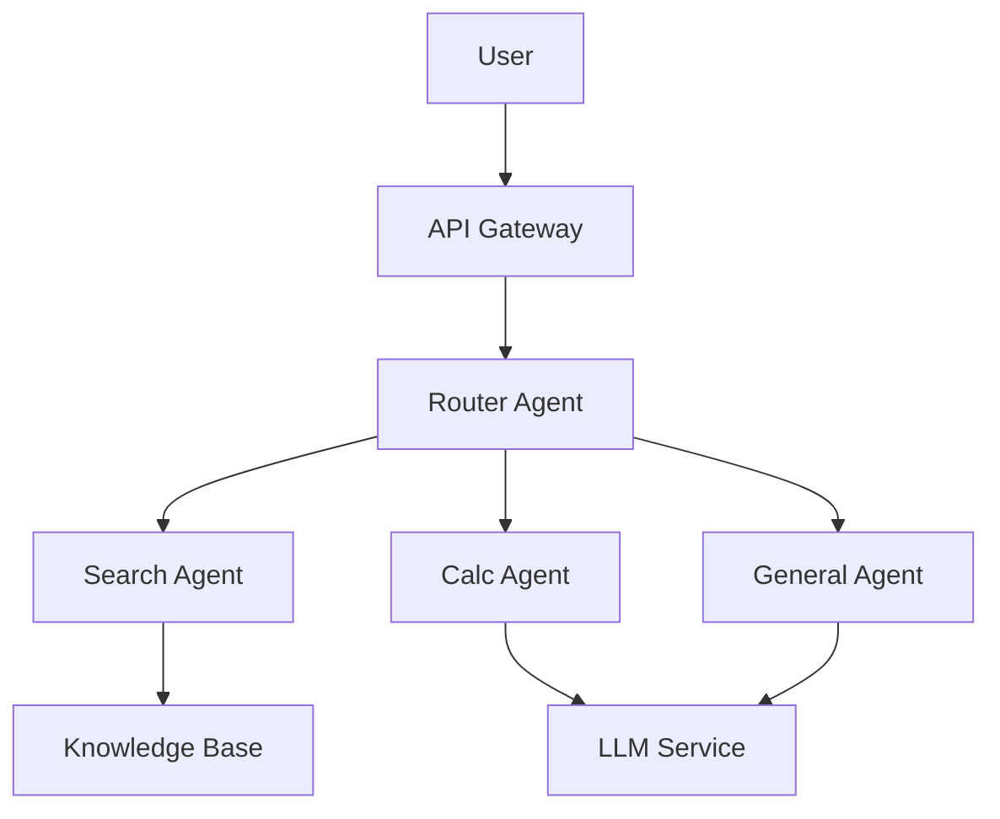
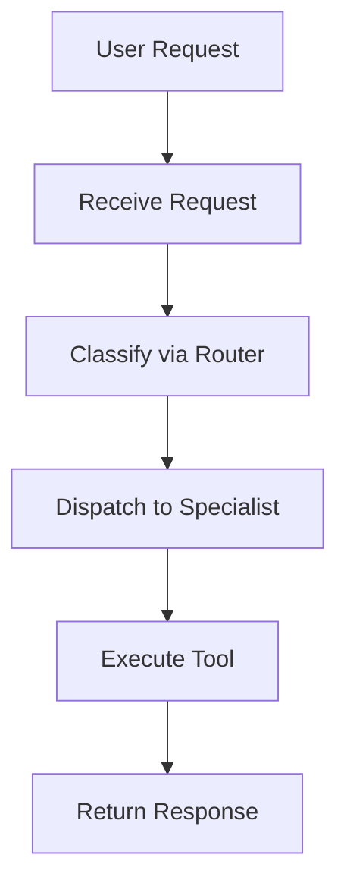
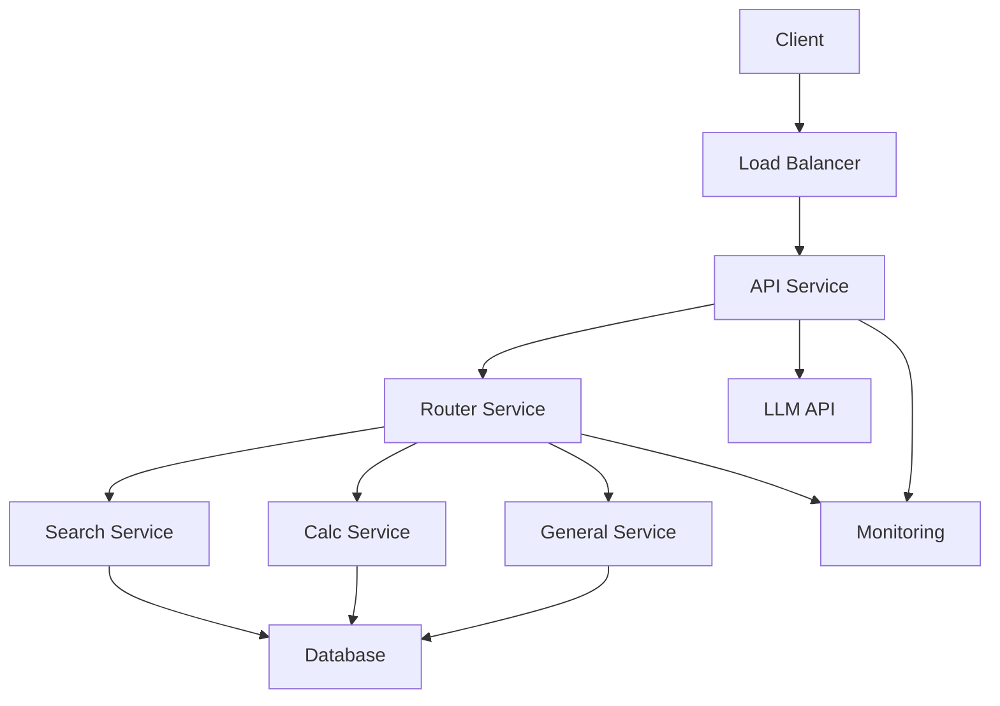
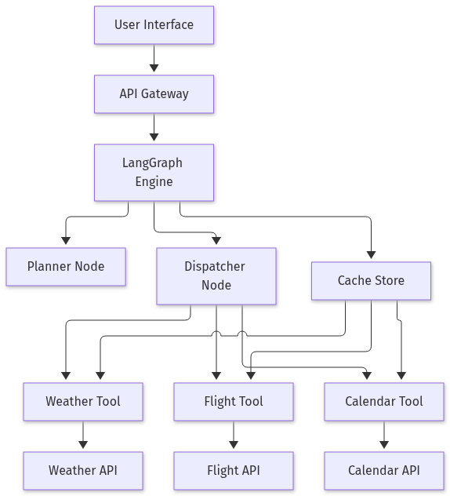
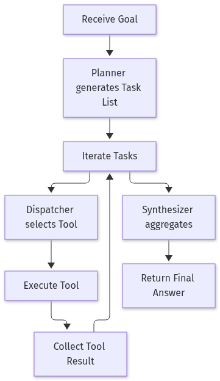
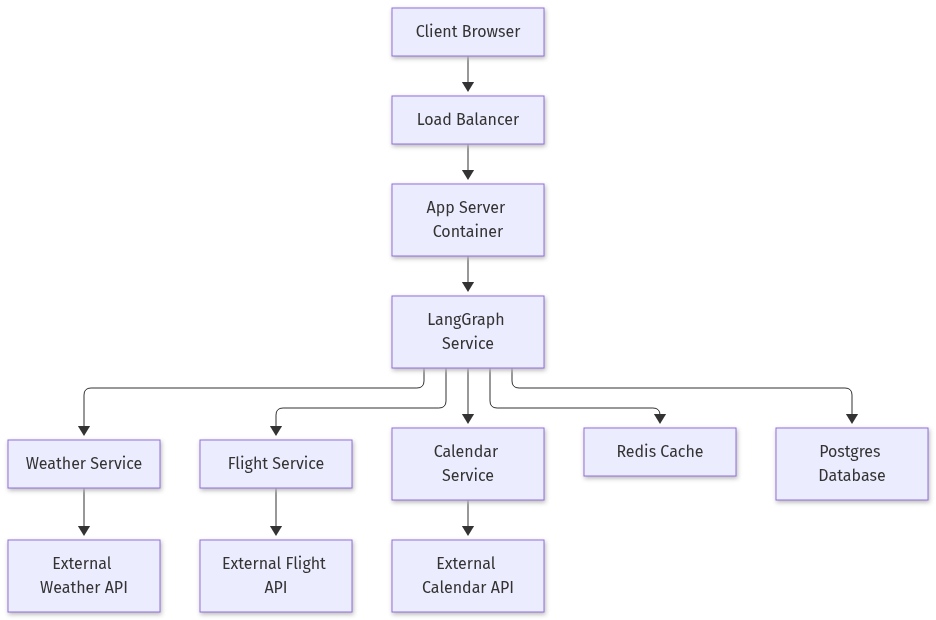

# Building a Task‑Routing AI Agent with LangChain: A Hands‑On Guide

## Introduction

Artificial intelligence agents have moved beyond single‑purpose chatbots to become orchestrators that can route tasks, collaborate, and reason like a small team of specialists. Recent reports such as the *LangChain State of AI Agents (2024)* highlight the importance of task routing and multi‑agent collaboration, while surveys (e.g., Masterman et al., 2024) describe the architectural patterns that make this possible. In this blog we’ll walk through a practical, end‑to‑end implementation of a task‑routing AI agent using LangChain and OpenAI’s GPT‑4o. You’ll see how to set up the environment, define a routing agent, add specialist agents that call tools, and evaluate the system—all with runnable Python code you can copy‑paste and run locally.

## Set Up the Development Environment

1. **Install Python 3.11+**  
   Download the latest Python installer from the official site and add it to your system `PATH`. Verify the installation:

   ```bash
   python --version
   ```

   You should see something like `Python 3.11.4`.

2. **Create a project folder** and open a terminal inside it.  
   ```bash
   mkdir ai-agent-demo
   cd ai-agent-demo
   ```

3. **Create a virtual environment** to isolate dependencies:

   ```bash
   python -m venv .venv
   source .venv/bin/activate   # Windows: .venv\Scripts\activate
   ```

4. **Install the required libraries**:

   ```bash
   pip install langchain openai python-dotenv
   ```

5. **Store your OpenAI API key** in a `.env` file so the key never ends up in source control:

   ```text
   # .env
   OPENAI_API_KEY=sk-...your‑key…
   ```

   Replace the placeholder with the key you received from the OpenAI dashboard.

6. **Verify the setup** by running a short script that queries the LLM:

   ```python
   # test_llm.py
   import os
   from langchain.llms import OpenAI
   from dotenv import load_dotenv

   load_dotenv()  # loads .env variables into os.environ
   llm = OpenAI(model="gpt-4o")

   response = llm("What’s the current year?")
   print(response)
   ```

   Execute the script:

   ```bash
   python test_llm.py
   ```

   If the output is `2026`, your environment is correctly configured and ready for building AI agents.

---

### Quick Checklist

- [x] Python 3.11+ installed  
- [x] Virtual environment activated  
- [x] `langchain`, `openai`, `python-dotenv` installed  
- [x] `.env` file contains `OPENAI_API_KEY`  
- [x] LLM call returns the current year  

With this foundation, you can start experimenting with LangChain’s agent abstractions and build more sophisticated workflows.

## Create a Routing Agent that Dispatches Tasks

In a multi‑agent system, the first decision a dispatcher must make is *who* should handle a given user request. LangChain’s `RouterChain` gives us a lightweight, LLM‑powered way to classify a prompt into a handful of categories and then hand it off to the appropriate specialist agent. Below is a minimal, fully runnable example that routes requests into three buckets: **SEARCH**, **CALC**, and **GENERAL**.

```python
from langchain.prompts import PromptTemplate
from langchain.chains import LLMChain
from langchain.llms import OpenAI

# 1️⃣ Define a prompt that tells the LLM how to classify the input.
router_prompt = PromptTemplate(
    input_variables=["input"],
    template="""
You are a task router. Classify the user request into one of three categories:
- SEARCH: the user wants information from the web or a knowledge base.
- CALC: the user needs a numeric or logical calculation.
- GENERAL: any other natural‑language question.
Return ONLY the category name.
User request: {input}
""",
)

# 2️⃣ Wrap the prompt in an LLMChain that will actually call the model.
router_chain = LLMChain(llm=OpenAI(model="gpt-4o"), prompt=router_prompt)

def route_task(user_input: str) -> str:
    """Return the routing category for a given user request."""
    category = router_chain.run({"input": user_input}).strip().upper()
    return category

# Demo
print(route_task("What’s the population of Tokyo?"))   # → SEARCH
print(route_task("What’s 12 * 47?"))                # → CALC
print(route_task("Tell me a joke about cats."))     # → GENERAL
```

### Why this works

The prompt explicitly lists the three categories and instructs the LLM to output *only* the category name. This keeps the response short and machine‑parsable, which is essential for downstream routing logic. The 2024 LangChain State of AI Agents report highlights that “better task routing ensures that the right agent handles the right problem at the right time” (LangChain, 2024), and our simple router is a direct implementation of that principle.

### Swapping the router

If you later need a more sophisticated classifier—say, one that supports additional categories or uses a fine‑tuned model—you can replace `router_chain` with any other `Chain` that returns the same string format. For example, you could plug in a `TextClassificationChain` trained on a labeled dataset, or even a rule‑based classifier for deterministic routing. The key is that the output remains a single, uppercase token that the dispatcher can match to a specialist agent. This modularity means you can iterate on routing logic without touching the rest of your agent network.

## Implement Specialist Agents and Enable Collaboration

When building an AI system that can answer questions, perform calculations, or fetch up‑to‑date information, the most maintainable approach is to split responsibilities into *specialist agents*. Each agent knows how to solve a narrow class of problems, and a lightweight orchestrator decides which one to invoke. Below is a minimal, fully runnable example that demonstrates this pattern.

```python
from langchain.tools import tool
from langchain.chains import LLMChain
from langchain.prompts import PromptTemplate
from langchain.llms import OpenAI
import math

# 1. SearchAgent (mocked for offline demo)
class SearchAgent:
    def run(self, query: str) -> str:
        # In a real project replace this with SerpAPIWrapper().run(query)
        return f"[Mocked search result for '{query}']"

# 2. CalcAgent using a tool
@tool
def calculate(expression: str) -> str:
    """Evaluate a simple arithmetic expression safely."""
    try:
        # eval is dangerous; we limit globals/locals
        result = eval(expression, {"__builtins__": {}}, {})
        return str(result)
    except Exception as e:
        return f"Error: {e}"

# 3. GeneralAgent
class GeneralAgent:
    def __init__(self):
        self.chain = LLMChain(
            llm=OpenAI(model="gpt-4o"),
            prompt=PromptTemplate(
                input_variables=["question"],
                template="Answer the question concisely: {question}"
            )
        )
    def run(self, question: str) -> str:
        return self.chain.run({"question": question})

# Orchestrator
class AgentOrchestrator:
    def __init__(self):
        self.search = SearchAgent()
        self.calc = calculate
        self.general = GeneralAgent()

    def handle(self, user_input: str) -> str:
        category = route_task(user_input)
        if category == "SEARCH":
            return self.search.run(user_input)
        elif category == "CALC":
            return self.calc(user_input)
        else:
            return self.general.run(user_input)

# Simple task router (you can replace this with a more sophisticated model)
def route_task(text: str) -> str:
    if any(word in text.lower() for word in ["calculate", "sum", "sqrt", "math"]):
        return "CALC"
    if any(word in text.lower() for word in ["who", "when", "where", "what"]):
        return "SEARCH"
    return "GENERAL"

# Demo run
orchestrator = AgentOrchestrator()
print(orchestrator.handle("What’s the square root of 144?"))   # CALC
print(orchestrator.handle("Who won the 2024 Formula 1 championship?"))  # SEARCH (mocked)
print(orchestrator.handle("Explain why task routing matters for AI agents."))  # GENERAL
```

### How the orchestrator mirrors multi‑agent collaboration

1. **Task routing** – `route_task` inspects the user query and tags it with a category. In production you might use a lightweight LLM or a rule‑based classifier.  
2. **Specialist selection** – The orchestrator holds a reference to each agent and delegates the call.  
3. **Context passing** – If a calculation depends on a search result, the orchestrator can first invoke `SearchAgent`, store the output, and then feed it into `CalcAgent`. This pattern keeps each agent focused while enabling cross‑communication.  

By keeping the orchestrator thin, you can swap out or upgrade individual specialists without touching the routing logic, exactly as described in the 2025 AI Agent Index’s multi‑agent collaboration pattern.

## Test, Debug, and Extend the System

```python
import logging
from agent_orchestrator import AgentOrchestrator  # your orchestrator implementation

logging.basicConfig(level=logging.INFO)

queries = [
    "Convert 45 miles to kilometers",
    "Summarize the LangChain State of AI Agents report",
    "Who is the CEO of Nvidia?",
]

orchestrator = AgentOrchestrator()
for q in queries:
    logging.info(f"User: {q}")
    answer = orchestrator.handle(q)
    logging.info(f"Answer: {answer}\n")
```

The harness above sends a diverse set of queries, logs the router’s routing decision, and prints each answer. To validate that specialists are functioning, add simple assertions:

```python
for q in queries:
    answer = orchestrator.handle(q)
    assert answer, f"Specialist failed to return a response for: {q}"
```

### Adding a New Specialist Without Touching the Router

```python
from langchain.tools import PythonREPLTool

class CodeAgent:
    """A lightweight agent that evaluates Python snippets."""
    def __init__(self):
        self.tool = PythonREPLTool()

    def run(self, code: str) -> str:
        return self.tool.run(code)

# Register the new agent with the orchestrator
orchestrator.code = CodeAgent()

# Quick test
print(orchestrator.code.run("[i for i in range(5)]"))  # ➜ [0, 1, 2, 3, 4]
```

The router remains untouched; it simply looks up the `code` attribute when a query matches the “code” intent. This pattern keeps the routing logic stateless and makes adding new specialists a matter of extending the orchestrator’s namespace.

### Troubleshooting Checklist

| Issue | What to check | Quick fix |
|-------|---------------|-----------|
| **API‑key errors** | Verify the key is set in the environment (`export OPENAI_API_KEY=…`) and that the key has the correct scope. | Re‑generate a key with the needed permissions. |
| **Rate‑limit exceeded** | Inspect the HTTP status code (429) and the `Retry-After` header. | Add exponential back‑off or throttle requests. |
| **Safe‑eval pitfalls** | Ensure the `PythonREPLTool` is sandboxed; avoid executing untrusted code. | Wrap calls in a try/except and restrict the environment. |

### Best‑Practice Tips

- Keep the router stateless; it should only decide *which* specialist to invoke, not *how* it runs.
- Version‑control prompts and tool configurations so regressions are easy to trace.
- Monitor token usage per specialist to spot cost spikes early.
- The same pattern scales to enterprise pipelines: dozens of specialists can be plugged in without modifying core routing logic, enabling modular, maintainable agent ecosystems.

## Conclusion

In this guide we walked through the essential steps to get a Python‑based AI agent up and running—from installing Python 3.11+, creating an isolated virtual environment, and securely loading your OpenAI API key, to confirming the setup with a simple LLM query. With the foundation in place, you can immediately start leveraging LangChain’s powerful abstractions, such as the `RouterChain`, to classify user intents and dispatch them to the appropriate downstream logic.

By structuring your system around a lightweight router and a suite of specialist agents (search, calculation, general‑purpose), you achieve both modularity and scalability. The router’s clear, token‑only output makes it easy to swap in more advanced classifiers or rule‑based systems without rewriting the orchestration layer, while each specialist remains focused on a narrow domain, simplifying maintenance and future enhancements. This pattern empowers you to build robust, collaborative AI agents that can evolve alongside your application’s growing needs.

## References & Further Reading

- [LangChain State of AI Agents Report: 2024 Trends](https://www.langchain.com/stateofaiagents)
- [The 2025 AI Agent IndexDocumenting Technical and Safety Features of Deployed Agentic AI Systems](https://arxiv.org/html/2602.17753v1)
- [AI agent - Wikipedia](https://en.wikipedia.org/wiki/AI_agent)
- [Agentic AI: a comprehensive survey of architectures, applications, and future directions | Artificial Intelligence Review | Springer Nature Link](https://link.springer.com/article/10.1007/s10462-025-11422-4)
- [AI Agents: Evolution, Architecture, and Real-World Applications](https://arxiv.org/html/2503.12687v1)
- [AI Agents: A New Architecture for Enterprise Automation | Menlo Ventures](https://menlovc.com/perspective/ai-agents-a-new-architecture-for-enterprise-automation)


### Diagram 1: High‑level System Architecture




### Diagram 2: Task Routing Workflow




### Diagram 3: Deployment Architecture




## Architecture Diagrams



*Figure 1: High‑level System Architecture for ai agent.*



*Figure 2: Task Routing Workflow for ai agent.*



*Figure 3: Deployment Architecture for ai agent.*