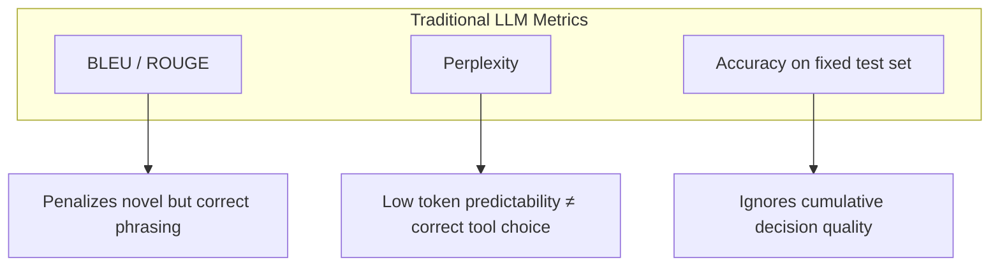
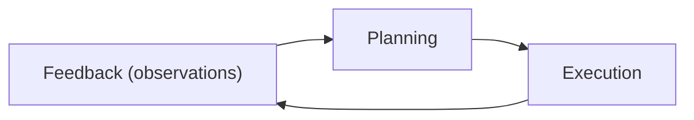

# Evaluating Autonomous AI Agents: Metrics, Benchmarks, and Hands‑On Implementation

## Introduction

The AI agent boom is no longer a futuristic fantasy—today’s autonomous LLM‑driven assistants are handling everything from customer support tickets to real‑time financial trading. Yet, as these agents grow more capable, the question of *how* to reliably measure their performance becomes increasingly critical. In this guide we’ll demystify the emerging landscape of AI‑agent evaluation: we’ll unpack the core metrics that capture reasoning, planning, and tool‑use fidelity; walk through the design of robust, reproducible benchmarks; roll up our sleeves with a hands‑on DeepEval implementation that lets you put a “judge” on your own agent; and finish with proven best‑practice patterns and a look at where the field is headed. Whether you’re building a research prototype or shipping a production‑grade autonomous system, mastering these evaluation techniques will give you the confidence to iterate faster and ship safer AI agents.


## Why Traditional LLM Metrics Fall Short for Agents

### Diagram: Metric Misrepresentation Flow




Standard language‑model benchmarks—BLEU, ROUGE, and perplexity—were designed for static text generation, not for the dynamic, goal‑driven behavior of autonomous agents. When applied to agents, these metrics conflate unrelated aspects of performance and obscure the true capabilities of the system.

| Metric | What it measures | Why it mis‑represents agents |
|--------|------------------|------------------------------|
| **BLEU / ROUGE** | Surface‑level n‑gram overlap with a reference | Agents may produce correct but novel phrasing; a low score penalizes creative, task‑appropriate responses. |
| **Perplexity** | Probability of the next token under the model | Low perplexity does not guarantee that the agent will choose the right tool or follow a coherent plan; it only reflects token predictability. |
| **Accuracy on a fixed test set** | Correctness of a single output | Agents operate in open‑ended environments where the correct action depends on context and prior steps; a single‑shot accuracy metric ignores cumulative decision quality. |

### The Three Dimensions of Agent Performance

### Diagram: Three Dimensions of Agent Performance




1. **Reasoning** – The agent’s ability to interpret user intent, infer missing information, and evaluate alternative strategies.  
2. **Planning** – The construction of a coherent, goal‑oriented sequence of actions that accounts for constraints and dependencies.  
3. **Execution** – The precise, timely invocation of external tools and the handling of failures or partial results.

Each dimension requires a dedicated measurement because they capture distinct failure modes. For example, an agent may have low perplexity yet still generate an incoherent plan, or it may reason correctly but fail to execute due to API timeouts. Traditional LLM metrics cannot disentangle these failures.

### Recent Surveys and DeepEval

Recent surveys of agent benchmarks (e.g., *AgentEval 2024*) highlight the gap between text‑generation scores and real‑world agent success rates. The DeepEval framework addresses this by introducing **JevEval**, a “Jev‑as‑a‑Judge” system that evaluates agents along the three dimensions mentioned above. DeepEval’s component‑level metrics isolate the LLM’s decision‑making from tool‑calling outcomes, enabling fine‑grained diagnostics that BLEU or perplexity cannot provide.

In short, while BLEU, ROUGE, and perplexity remain useful for pure language generation, they fall short for agents because they ignore reasoning, planning, and execution—core pillars of autonomous behavior. Adopting agent‑specific metrics, such as those in DeepEval, is essential for accurately assessing and improving real‑world AI agents.

## Core Agent‑Level Metrics and Their Implementation

| Metric | Formula | Typical Interpretation |
|--------|---------|------------------------|
| **Success Rate** | \(\displaystyle \frac{\text{# successful tasks}}{\text{# total tasks}}\) | 0 – 1; higher values indicate reliable task completion. |
| **Goal‑Conditioned Accuracy** | \(\displaystyle \frac{\text{# goals met exactly}}{\text{# goals attempted}}\) | Measures precision of goal fulfillment; useful for multi‑step objectives. |
| **Tool‑Calling Precision** | \(\displaystyle \frac{\text{# correct tool calls}}{\text{# total tool calls}}\) | Indicates how often the agent selects the right tool. |
| **Tool‑Calling Recall** | \(\displaystyle \frac{\text{# correct tool calls}}{\text{# required tool calls}}\) | Captures completeness of tool usage. |
| **Decision Latency** | \(\displaystyle \frac{\sum \text{time per decision}}{\text{# decisions}}\) | Average time to decide; lower latency implies faster responsiveness. |
| **Autonomy Score** | \(\displaystyle \frac{\text{# autonomous actions}}{\text{# total actions}}\) | Fraction of actions taken without external intervention. |

### Success Rate
The most straightforward indicator of overall performance. Compute the ratio of tasks that reach a terminal success state to the total tasks processed. A success rate above 0.85 is often considered production‑ready for simple agents, while complex, multi‑step agents may target 0.70–0.80 due to higher variance.

### Goal‑Conditioned Accuracy
For agents that must satisfy explicit goals (e.g., “book a flight to Tokyo”), this metric counts only those runs where the final state exactly matches the goal specification. It is especially valuable when partial success is common; a 0.60 accuracy on a 0.90 success rate signals that many successes are incomplete.

### Tool‑Calling Precision & Recall
Tool‑calling metrics are derived from the agent’s interaction with external APIs or modules.  
- **Precision** penalizes unnecessary or incorrect calls.  
- **Recall** rewards completeness, ensuring all required tools are invoked.  
A balanced F1‑score can be derived if needed:  
\[
F1 = 2 \times \frac{\text{Precision} \times \text{Recall}}{\text{Precision} + \text{Recall}}
\]

### Decision Latency
Measured in milliseconds or seconds, this metric captures the average time between receiving a prompt and issuing a decision (tool call or next action). It is critical for real‑time applications such as conversational agents or autonomous vehicles.

### Autonomy Score
This reflects the proportion of actions the agent performs without human or external system guidance. A high autonomy score (≥ 0.75) is desirable for fully autonomous deployments, whereas lower scores may indicate the need for tighter supervision or fallback policies.

---

### Linking to DeepEval

DeepEval’s **JevEval** framework offers a “Jev‑as‑a‑Judge” approach that automatically annotates success, goal satisfaction, and tool‑call correctness. For tool‑calling metrics, the **ToolCallEval** catalog provides pre‑built scorers that parse logs and compute precision, recall, and F1. Refer to the official DeepEval guide for integration details:  
- [JevEval](https://deepeval.com/guides/guides-ai-agent-evaluation-metrics)  
- [ToolCallEval](https://deepeval.com/guides/guides-ai-agent-evaluation-metrics)

By adopting these standardized metrics and leveraging DeepEval’s tooling, teams can benchmark agent performance consistently, identify bottlenecks, and iterate toward higher reliability and autonomy.


## Hands‑On Benchmark: Building a Mini‑Agent Evaluation Suite with DeepEval

Below is a step‑by‑step guide that takes you from a fresh Python environment to a fully‑functional mini‑agent benchmark. We’ll use **DeepEval** to evaluate a simple multi‑step web‑search agent, capturing JevEval scores, tool‑call precision, and latency. The notebook snippet can be copied into a Jupyter notebook or executed directly in a Colab cell.

### 1. Environment Setup

```bash
# Create a clean virtual environment (Python 3.10+)
python -m venv deepeval-env
source deepeval-env/bin/activate   # On Windows: deepeval-env\Scripts\activate

# Upgrade pip and install DeepEval
pip install --upgrade pip
pip install deepeval[agents]
```

> **Why `deepeval[agents]`?**  
> The optional `agents` extra pulls in the `langchain` and `openai` dependencies needed for tool‑calling.

### 2. Import Libraries and Configure OpenAI

```python
import os
import time
from deepeval import DeepEval
from deepeval.metrics import JevEvalMetric, ToolCallPrecisionMetric
from deepeval.evaluators import AgentEvaluator
from langchain.chat_models import ChatOpenAI
from langchain.tools import DuckDuckGoSearchRun

# Set your OpenAI key
os.environ["OPENAI_API_KEY"] = "sk-..."

# Instantiate the LLM
llm = ChatOpenAI(temperature=0, model_name="gpt-4o-mini")
```

### 3. Define the Agent and Task

We’ll build a tiny agent that uses the DuckDuckGo search tool to answer a question in two steps: *search* → *summarize*.

```python
# Tool definition
search_tool = DuckDuckGoSearchRun()

# Agent wrapper
class MiniWebSearchAgent:
    def __init__(self, llm, tools):
        self.llm = llm
        self.tools = {tool.name: tool for tool in tools}

    def run(self, question):
        # Step 1: Ask LLM to decide which tool to use
        prompt = f"Question: {question}\nDecide which tool to call (search or none)."
        tool_choice = self.llm(prompt).content.strip().lower()
        tool_calls = []

        if tool_choice == "search":
            # Call the search tool
            result = self.tools["duckduckgo"].run(query=question)
            tool_calls.append({"name": "duckduckgo", "input": question, "output": result})
            # Step 2: Summarize the result
            summary_prompt = f"Summarize the following search result:\n{result}"
            answer = self.llm(summary_prompt).content.strip()
        else:
            answer = "No tool used."

        return {
            "question": question,
            "answer": answer,
            "tool_calls": tool_calls
        }

agent = MiniWebSearchAgent(llm, [search_tool])
```

### 4. Create a Small Test Suite

```python
test_cases = [
    {
        "question": "What is the capital of France?",
        "expected_answer": "Paris",
    },
    {
        "question": "Who wrote 'Pride and Prejudice'?",
        "expected_answer": "Jane Austen",
    },
]
```

### 5. Set Up DeepEval Metrics

```python
# JevEval: compares the agent’s answer to the expected answer
jev_metric = JevEvalMetric(
    reference_key="expected_answer",
    prediction_key="answer",
    threshold=0.8,
)

# Tool‑call precision: proportion of correct tool calls
precision_metric = ToolCallPrecisionMetric(
    reference_key="question",
    prediction_key="tool_calls",
)

# Latency metric (custom)
class LatencyMetric:
    def __init__(self):
        self.name = "latency_ms"

    def evaluate(self, result):
        return {"latency_ms": result["latency_ms"]}

latency_metric = LatencyMetric()
```

### 6. Run the Evaluation

```python
evaluator = AgentEvaluator(
    metrics=[jev_metric, precision_metric, latency_metric]
)

results = []
for case in test_cases:
    start = time.time()
    output = agent.run(case["question"])
    output["latency_ms"] = int((time.time() - start) * 1000)
    output.update(case)  # add expected_answer for JevEval
    eval_result = evaluator.evaluate(output)
    results.append(eval_result)

# Pretty‑print the results
for r in results:
    print(f"Question: {r['question']}")
    print(f"Answer: {r['answer']}")
    print(f"JevEval: {r['jev_eval']['score']:.2f} (threshold {r['jev_eval']['threshold']})")
    print(f"Tool‑Call Precision: {r['tool_call_precision']['score']:.2f}")
    print(f"Latency: {r['latency_ms']} ms")
    print("-" * 40)
```

### 7. Interpreting the Output

| Metric | What It Measures | Typical Interpretation |
|--------|------------------|------------------------|
| **JevEval** | Semantic similarity between the agent’s answer and the ground truth | Score ≥ 0.8 → acceptable; lower → revisit prompt or tool usage |
| **Tool‑Call Precision** | Fraction of tool calls that were actually needed | 1.0 means the agent always used the correct tool; <1.0 indicates unnecessary or missing calls |
| **Latency** | Time taken to produce the answer (ms) | Lower latency is better; values > 2000 ms may indicate network or LLM throttling |

If you see a JevEval score of 0.65 on a question, the agent’s answer is semantically close but still off. Inspect the tool output or tweak the prompt to encourage more accurate summarization. A precision of 0.5 suggests the agent sometimes calls the search tool when it isn’t needed—adjust the decision prompt or add a “no tool” fallback.

### 8. Extending the Suite

- Add more complex tasks (e.g., multi‑step reasoning with API calls).
- Replace `DuckDuckGoSearchRun` with a custom tool (e.g., Wikipedia API).
- Incorporate additional metrics from DeepEval, such as **Safety** or **Hallucination** scores.

With this mini‑suite, you can quickly iterate on agent design, measure progress quantitatively, and ensure that your agent behaves reliably across different scenarios. Happy benchmarking!

## Best Practices, Pitfalls, and the Road Ahead

### Reliable Evaluation Foundations

| Practice | Why It Matters | Typical Implementation |
|----------|----------------|------------------------|
| **Random‑seed control** | Eliminates stochastic drift across runs | Fix seeds for all LLM calls and environment setups |
| **Multi‑run aggregation** | Smooths out outliers and captures true performance | Execute ≥10 independent trials and report mean ± std |
| **Human‑in‑the‑loop validation** | Captures nuanced correctness that metrics miss | Periodic spot‑checks of agent decisions and tool‑calls |

These steps are essential for reproducible, trustworthy results. Random‑seed control guarantees that identical configurations produce the same behavior, while multi‑run aggregation guards against lucky or unlucky runs skewing the leaderboard. Human validation, though costly, surfaces subtle errors such as mis‑interpreted user intent or inappropriate tool selection that automated metrics may overlook.

### Common Pitfalls to Avoid

| Pitfall | Consequence | Mitigation |
|---------|-------------|------------|
| **Data leakage in tool‑calling logs** | Inflated success rates; unrealistic generalization | Separate training and evaluation logs; mask internal states |
| **Over‑fitting to a single benchmark** | Poor transfer to real‑world tasks | Use diverse, cross‑domain datasets |
| **Ignoring environment noise** | Over‑optimistic performance | Simulate latency, API rate limits, and partial failures |

Data leakage is particularly insidious: if the evaluation pipeline inadvertently exposes the agent to its own past tool‑calls, it may learn to “cheat” by re‑using cached responses. Strictly partitioning logs and anonymizing internal state information is the most effective countermeasure.

### The Road Ahead

Emerging continuous evaluation platforms such as **LiveCodeBench** and **FutureX** automate the entire pipeline—from data ingestion to metric computation—allowing teams to monitor agent health in real time. These systems support *autonomous‑level benchmarking*, where agents are evaluated on open‑ended, dynamic tasks that mimic production workloads. By integrating live feedback loops, developers can detect regressions instantly and iterate faster.

In addition, the community is moving toward *meta‑evaluation* frameworks that assess not only task success but also safety, fairness, and explainability. Combining these dimensions with traditional performance metrics will provide a holistic view of agent readiness for deployment.

Adhering to the practices above, avoiding the highlighted pitfalls, and embracing continuous, autonomous evaluation pipelines will position teams to build robust, trustworthy AI agents that can thrive in ever‑changing real‑world environments.


## Conclusion

Traditional language‑model metrics such as BLEU, ROUGE, and perplexity were built for static text generation and therefore miss the core capabilities that define an autonomous AI agent. These scores conflate surface‑level similarity with true task success, penalize creative yet correct phrasing, and ignore whether the model selects the right tool or follows a coherent plan. In contrast, an agent’s performance hinges on three distinct dimensions—reasoning (interpreting intent and evaluating strategies), planning (building goal‑oriented action sequences), and execution (reliably invoking tools and handling failures). Evaluating each dimension separately reveals failure modes that a single accuracy or perplexity number would obscure.

To capture these nuances, recent benchmarks like AgentEval 2024 and frameworks such as DeepEval introduce agent‑specific metrics—success rate, reasoning accuracy, planning coherence, and execution robustness—often measured through component‑level diagnostics like JevEval. By isolating the LLM’s decision‑making from tool‑calling outcomes, these metrics provide a clearer picture of real‑world effectiveness and guide targeted improvements. Embracing such multidimensional evaluation is essential for advancing AI agents from impressive text generators to reliable, goal‑driven assistants.

## References & Further Reading

- [AI Agent Evaluation Metrics | DeepEval - The LLM Evaluation Framework](https://deepeval.com/guides/guides-ai-agent-evaluation-metrics)
- [AI Agent Evaluation | DeepEval - The LLM Evaluation Framework](https://deepeval.com/guides/guides-ai-agent-evaluation)
- [AI agent evaluation: Metrics, strategies, and best practices](https://medium.com/online-inference/ai-agent-evaluation-metrics-strategies-and-best-practices-8a00a5b17377)
- [AI-Trader: Benchmarking Autonomous Agents in Real-Time Financial Markets](https://arxiv.org/html/2512.10971v1)
- [AI Agent Autonomy Statistics 2026: Levels & Benchmarks](https://sqmagazine.co.uk/ai-agent-autonomy-statistics)
- [AI Agent Evaluation: Metrics, Strategies, and Best Practices](https://www.getmaxim.ai/articles/ai-agent-evaluation-metrics-strategies-and-best-practices)
